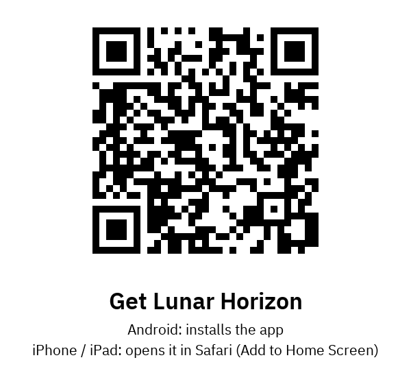
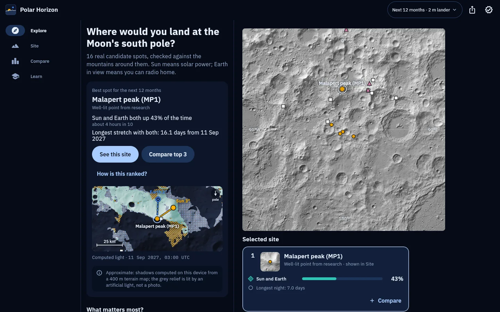
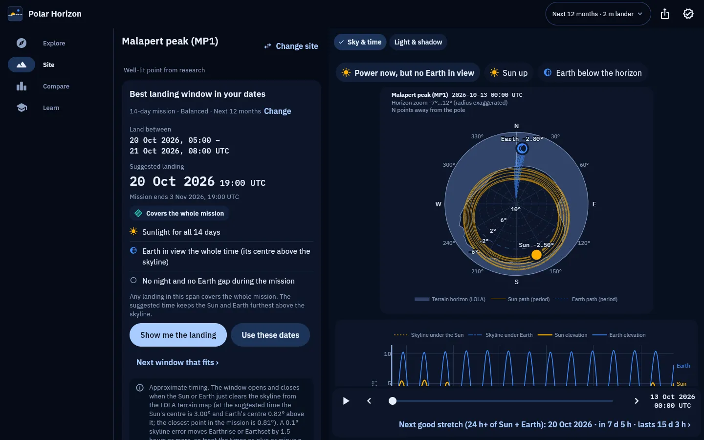
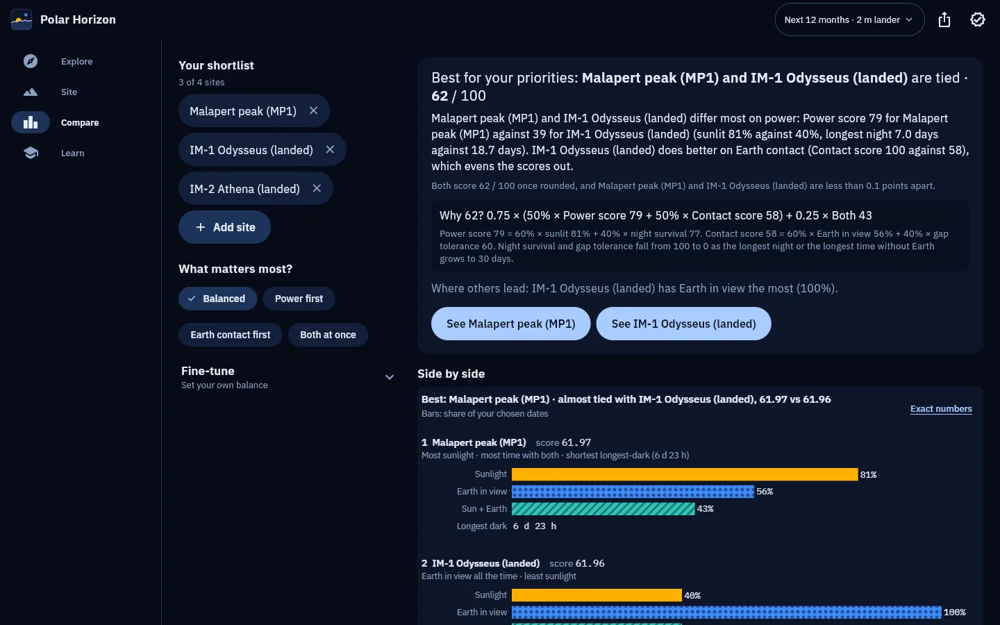
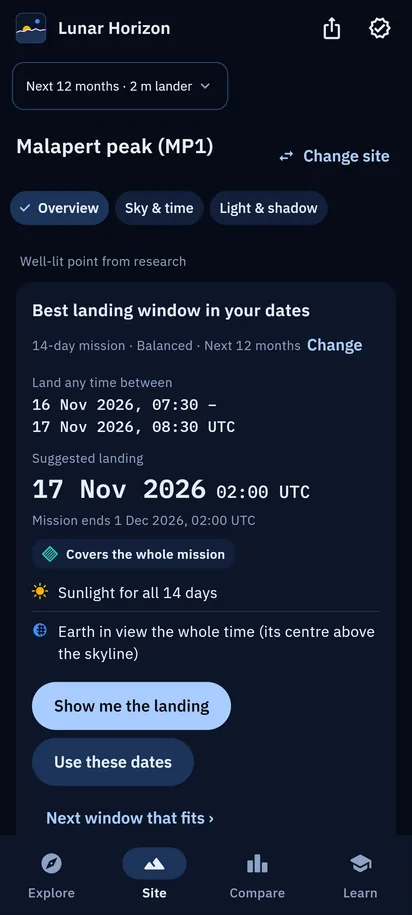
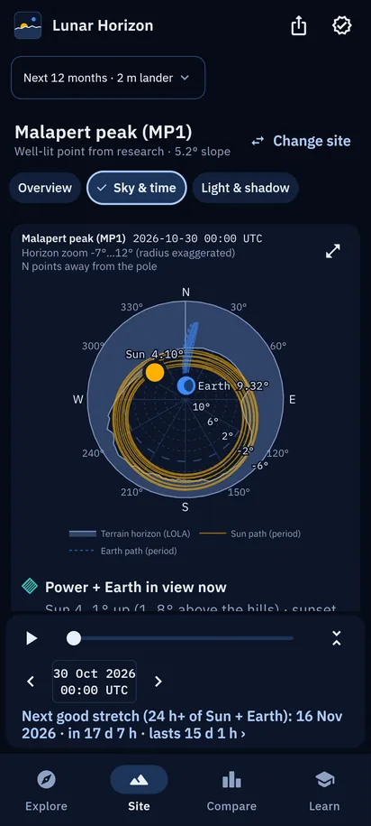
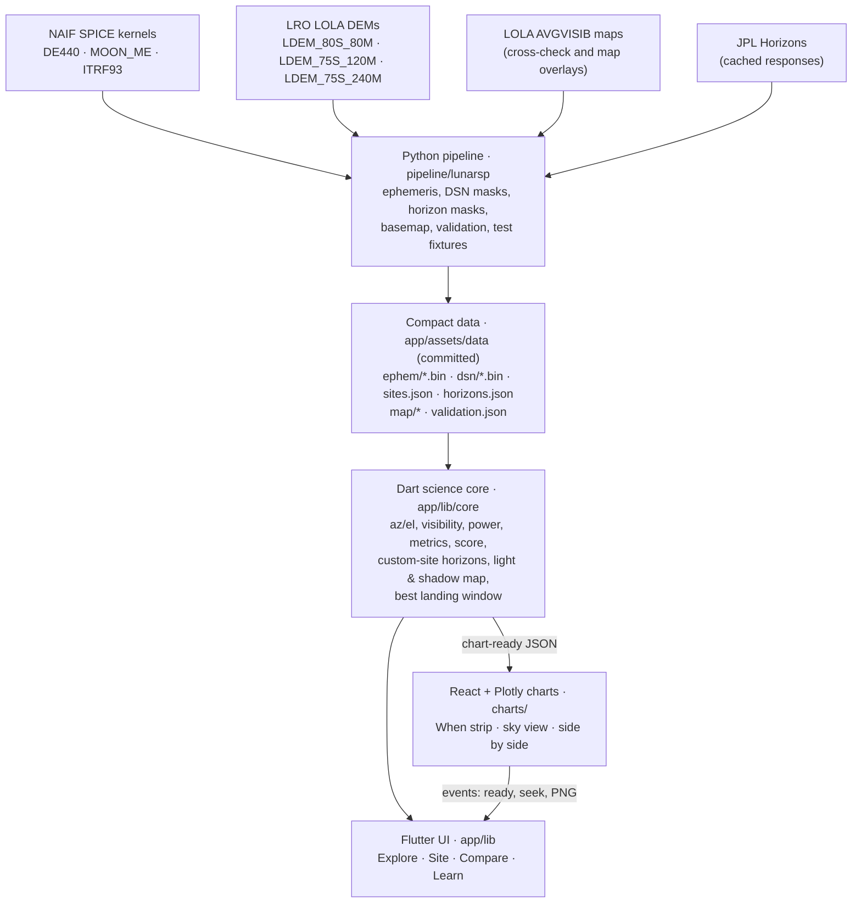

# Lunar Horizon

**A lunar south-pole site and date planner. This is a NASA Space Apps entry.**

Lunar Horizon answers one question: *which south-pole landing site, on which dates, gives the best solar power and direct-to-Earth communication?* For each site it works out when the Sun and the Earth are above the real terrain horizon. It uses NASA/JPL SPICE ephemerides and Lunar Reconnaissance Orbiter (LRO) LOLA elevation data, and turns the results into rankings, charts, a light-and-shadow map and plain-language summaries. It is built for:

- **the public and educators:** a plain answer first, with explanations next to each view
- **mission planners:** exact numbers, adjustable visibility rules, and CSV export with provenance

The same Flutter code runs as a web app and on Android.

> **Status.** Complete: Explore (the map with every site ranked), Site (Overview, Sky & time with the classic sky plot and timeline, and the light & shadow map), Compare and Learn, plus the *best landing window* finder. Suggested landings keep the Sun and Earth at least 0.25° above the skyline. Code: [localizedprojects/CLPS-MOON-BROWSER](https://github.com/localizedprojects/CLPS-MOON-BROWSER). Web app: <https://localizedprojects.github.io/CLPS-MOON-BROWSER/>.

### Get the app

Scan the code with your phone's camera. It opens <https://localizedprojects.github.io/CLPS-MOON-BROWSER/get/>, which picks the right install for the device:

- **Android:** downloads [lunar-horizon.apk](https://github.com/localizedprojects/CLPS-MOON-BROWSER/releases/latest/download/lunar-horizon.apk) from the [latest release](https://github.com/localizedprojects/CLPS-MOON-BROWSER/releases/latest). Open it and allow installing from your browser when Android asks (Android 7.0 or newer; signed with a development key, so it is installed directly, not from the Play Store). If you later switch to the Play Store version (or a build signed with a different key), uninstall this one first; Android will not update across signing keys.
- **iPhone and iPad:** opens the web app in Safari; use Share, then *Add to Home Screen* to keep it as an app. (Installing an iOS app file needs a paid Apple Developer account; the page has one switch, `IOS_URL` in `app/web/get/index.html`, for a TestFlight or App Store link later, and the QR code stays the same.)
- **Computers:** <https://localizedprojects.github.io/CLPS-MOON-BROWSER/>
- **Privacy:** no accounts, no analytics, no ads, no tracking; see the [privacy policy](https://localizedprojects.github.io/CLPS-MOON-BROWSER/privacy/).



### Screenshots

Release web build, Next 12 months, 2 m lander, default rules: the MP1 landing window with Sky & time and the phone Sky & time from 13 October 2026 (the classic sky plot and timeline); Explore, Compare and the phone landing card from 12 October 2026.

| Explore | Malapert peak (MP1): best landing window and Sky & time |
|---|---|
|  |  |

| Compare | Phone: landing window | Phone: Sky & time |
|---|---|---|
|  |  |  |

---

## What you can do

It opens with a short animation (the Sun skimming along the south-pole horizon, as it does there), which always plays through. On a first launch the app then asks **what matters most** for your mission (balanced, solar power, or Earth contact); your answer ranks the sites (a loading scene shows the real progress; its bar never runs ahead of the work), and the app remembers it. Later launches play only the opening animation and fade straight into Explore, ranked for the last goal chosen (on that page or with the goal chips on Explore). It has four destinations, in a bottom bar: **Explore**, **Site**, **Compare** and **Learn**. The first time you open each of them (and each Site tab), a short guide lights its main controls one at a time, with a line on what each does; Learn's *Show the guides again* replays them. A context pill at the top shows the chosen period and observer height (and "custom rules" when the Sun, Earth or DSN rules differ from the defaults), and opens Mission settings.

- **Explore: find the best site for your dates.** All 16 preset sites (and any custom spots) are ranked for the chosen period, which defaults to the next 12 months.
  - The answer comes first: a top-pick card names the best spot, how much of the time the Sun and Earth are both up, and its longest stretch with both. Below it is a computed light snapshot of that site at the start of that stretch.
  - "What matters most?" chips re-rank the sites by goal: *Balanced* (the default), *Power first* or *Earth contact first*.
  - Site cards show a terrain thumbnail, bars for sunlight, Earth in view and both together, and the longest night. On phones and tablets Explore shows the terrain map with the top pick and a row of site cards under it; on wide screens the list and the map sit side by side. A tray collects sites to compare.
- **Site: everything about one site**, in three tabs (deep links `#/site/<id>/overview`, `/sky` and `/light`):
  - **Overview:** *When should you land here?*: pick a surface-mission length (1 to 30 days, 14 by default) and *Find the best landing window* returns the earliest span of landing times in your dates whose whole mission keeps the Sun and Earth above the skyline, with a suggested landing and the mission's end. If no window fits, it gives the closest fit for your goal and the longest Sun + Earth stretch there is. *Use these dates* sets the period around the answer, *Next window that fits* moves on, and an approximation badge states how far the timing can be trusted. Next, *At a glance*: what the place is, why it is on the list (or, for your own spot, what stands out against the catalogue sites), what to watch out for and how it ranks. Catalogue sites are described from published, fact-checked sources, listed under *Details and sources*; your own spots are described by the app from its own numbers, with the coarse-map lines marked approximate. Then, under *More about this site*, a light snapshot of the best moment or of the middle of the longest night; the three headline shares; *Best time to be here* (the longest Sun + Earth stretch, with *Show me* and *See the light at that moment*); a *Which days work?* calendar of good days (Sun and Earth up together at least half the UTC day, with the best stretch outlined); *Plan for the dark* (the longest night that batteries and heaters must last, and the longest time without Earth); and *About this site*, with the source, slope and the 18.6-year average sunlight and Earth visibility for catalogue sites.
  - **Sky & time:** status chips for the Sun, the Earth and power + contact at the cursor; a **sky plot** of the site's real terrain skyline with the Sun's and Earth's paths over the period and their positions and heights at the time shown; a **timeline** of the Sun's and Earth's heights over the period against the skyline beneath each, with bars for when the Sun, Earth and both together are up (tap it to jump there); and a time bar to play, scrub, step by day or jump to the next Sun + Earth stretch (a good one, 24 h or more, first). Touch any chart (here or on Compare) to see it alone, full screen, as a still picture made at the screen's size (only its X closes it); the timeline turns a phone or tablet sideways there. A *Simple view* switch shows plain-words versions instead: a *When* answer (when Sun and Earth are next up together and for how long, the next dark spell, when Earth next comes into view), a timeline of the stretches with their durations for the next 2 weeks, 2 months or the whole period, a *Coming up* list, and a *Where to look* sky view.
  - **Sky & time** and **Light & shadow** share a time bar: Play, a day back or forward and a slider. Play hides the top bars so the charts stay still; they come back when you scroll to the very top. The time bar folds into a slim strip with its chevron, and the app remembers that.
  - **Light & shadow:** computed light and shadow on the terrain map for the selected moment, traced on the device from the LOLA elevation model. Choose a 128 km close-up around the site or the whole region inside 80°S, and a *Sunlight*, *Earth view* or *Both* layer. Sun and Earth bearing arrows start at the site; a legend gives the share of the area that is sunlit or sees Earth, and a badge states the measured accuracy (see [Validation](#validation)). Play moves ten hours per step here, so the shadows sweep at a readable pace; while playing the map is drawn at half resolution and says so, and pausing brings back full detail.
- **Compare: two to four sites with a transparent score.** Pick a shortlist, choose a goal or fine-tune the weights (power against communication, and the weight of having both up together). A winner card states the best site for your priorities and the worked arithmetic of its score ("Why N?"), with a note when the top two tie after rounding. A *Side by side* chart (each site's score, sunlight, Earth in view, Sun + Earth together and longest dark), ranked cards, a *Good days by month* table and all the numbers follow.
- **Test your own spot.** Zoom the map (the + and − buttons, or pinch) and tap anywhere south of 80°S and confirm with *Check this spot*, or type the coordinates. The app computes that spot's horizon on the device and runs the same time-series, metric and score calculations as for a preset site. The result is labelled as lower fidelity (see [Assumptions and limitations](#assumptions-and-limitations)).
- **Change the mission rules** (Mission settings sheet):
  - the period
  - the observer height: a 2 m lander or a 10 m mast
  - when the Sun counts as visible: any part of the disk (the default), the disk centre, or the whole disk
  - when the Earth counts as visible: its centre (the default) or any part
  - an optional rule that a Deep Space Network (DSN) station must have the Moon in view
  - *Show exact numbers (for mission planners)*, which adds the full readouts
- **Share & export.** The sheet offers:
  - a time-series CSV whose header records the ephemeris, frame and rules
  - a scorecard CSV
  - PNG images of the Sky & time charts and of the comparison chart

  On the web the files download through the browser. On Android they open the share sheet.
- **Learn and check.** Learn explains how the app works and what each view shows, has a glossary, how the score works (with a worked example for the current top site), *How it's calculated*, the keyboard shortcuts and the credits, and an *Explain as I go* switch that adds a short explanation next to each chart and map. Its "Can I trust these numbers?" section opens the *Validation & assumptions* page, which reads `app/assets/data/validation.json` directly.

The project rules require a screen-reader label on every interactive control and tap targets of at least 48 dp. Placing a custom site also works from the keyboard. By design, colour is never the only way something is shown: shapes, patterns and direct labels carry the same meaning (for example the Sun, Earth and "both" glyphs in `app/lib/widgets/glyphs.dart`).

### The 16 preset sites

All coordinates come with citations in `app/assets/data/sites.json`.

| Group | Sites | Source of coordinates |
|---|---|---|
| Artemis III candidate regions (8) | Haworth, Malapert Massif, Mons Mouton Plateau, Mons Mouton, Nobile Rim 1, Nobile Rim 2, de Gerlache Rim 2, Peak near Cabeus B | Approximate centres of the roughly 15 × 15 km regions, from LROC mosaic extents and Henriksen et al. (2023). These are **not** official landing points. Slater Plain is omitted because no published centre was found. |
| High-illumination points (5) | SR1, CR1, SV1, MP1, GR1 | Points given in De Rosa et al. (2012), Table 2: the centres of its regions of interest |
| Missions (3) | IM-1 Odysseus (landed), IM-2 Athena (landed), VIPER mission-area centre | LROC landed positions and published mission-area centres |

---

## How it works



The work is split between offline precomputation and on-device computation:

- **Offline:** the Python pipeline does the heavy, data-hungry work once. It needs about 570 MB of downloads (about 605 MB with the optional DE442 kernel).
- **On the device:** the app ships compact results (Sun and Earth vectors, DSN masks, horizon masks, map images and a 400 m DEM reaching about 75°S; about 9.6 MB) and computes the time series, metrics, scores, custom-site horizons and the light and shadow map itself. This lets any custom location work without a server.
- **Charts:** these are render-only. Flutter sends them chart-ready JSON (`window.phRender`) and they post events back. The message schema is in `charts/src/bridge.ts` and `app/lib/widgets/chart_bridge.dart`.

**Key methods.** The full maths, with `file:line` references, is in [formula.md](formula.md).

- **Ephemeris.** SPICE computes the apparent Sun and Earth vectors (light time plus stellar aberration, `LT+S`) from the Moon's centre, in the body-fixed `MOON_ME` frame. They are sampled hourly from 2025 to 2035 and stored as float32, one file per year. The app interpolates them with a 4-point Lagrange scheme (formula.md §2).
- **Site geometry.** The app subtracts the site vector (topocentric parallax) and rotates the result into local East-North-Up, using the spherical normal, to get azimuth, elevation and range (§3).
- **Terrain horizon.** A ray-march over the LOLA DEM on an exact sphere (§5):
  - Preset sites use the 80 m DEM, then the 240 m DEM, with rays marched to 600 km (the 240 m grid ends at 75°S, about 457 km from the pole, and nothing beyond it is sampled), at a 0.25° azimuth step, for 2 m and 10 m observers.
  - Custom sites use the 400 m DEM, computed on the device, at a 0.5° step out to 300 km. That DEM is the 80 m DEM averaged to 400 m inside 80°S and the 120 m DEM (`LDEM_75S_120M`) averaged to 400 m beyond it, out to about 456 km from the pole (75.05°S on the axes).
- **Visibility.** The Sun's and Earth's angular radius is asin(R / r). The visible fraction of each disk is integrated over 16 strips against the jagged horizon (§6).
- **Power proxy.** 1361 W/m² × (1 au / r)² × the visible fraction of the solar disk: the sunlight on a panel facing the Sun (§7). A vertical panel turned toward the Sun would get cos(elevation) times this: within 0.1 % while the Sun is below 2.5° (most of the time near the pole), about 2 % at the 11° the Sun can reach at 80°S.
- **DSN check.** At least one of Goldstone, Madrid or Canberra must see the Moon's centre at 10° elevation or more. Earth orientation comes from ITRF93 (§8).
- **Metrics** (§9):
  - computed on a time grid of 10 min (periods up to 60 days), 30 min (up to 366 days, including the default 12 months) or 60 min (longer)
  - % of time sunlit, % Earth visible, and % with both
  - the longest sunlit, dark, Earth-visible and outage runs
  - mean power and energy
- **Score** (§10):
  - Score = (1 − b) × [a × Power + (1 − a) × Comms] + b × Both.
  - Power = 60 % sunlit + 40 % night survival. Comms = 60 % Earth visible + 40 % outage tolerance.
  - Night survival and outage tolerance fall linearly to 0 at a 30-day gap.
  - Compare and Learn show this formula with the weights in use. Compare's winner card and Learn's *How the score works* show the worked "Why N?" arithmetic (`scoreWhy` in `ranking.dart`), which evaluates to within 0.6 points of the score. The scorecard CSV adds the Power and Comms parts.
- **Light and shadow map.** A heightfield shadow sweep along rotated rows (a lagged running maximum) over the 400 m or 800 m DEM grid (§12):
  - It is run for the Sun's upper limb, the Sun's lower limb and the Earth's centre.
  - It adds a Lambert slope term for shading.
  - It runs in a worker isolate on Android (and desktop builds) and in short slices on the main thread on the web.
- **Summaries.** The plain-language sentences are generated from the computed metrics, never written by hand (§11).

### Data pipeline

The Python pipeline in `pipeline/` turns NASA's SPICE kernels and LOLA terrain maps into the compact files in `app/assets/data/`: hourly Sun and Earth positions and DSN contact bits for 2025-2035, the 16 preset sites with their horizon masks, the map layers and 400 m DEM, and the accuracy report. A small kernel-free step (`python -m lunarsp.curated`) turns the fact-checked site descriptions in `pipeline/research/site_overviews_verified.json` into `app/assets/data/curated_sites.json` for *At a glance*. It also writes the SPICE answer key that the Dart tests check against (`app/test/fixtures/spice_truth.json`). The app ships this output, committed to the repository, so nobody needs to run the pipeline or download its data to use or build the app. [pipeline/README.md](pipeline/README.md) explains each input, step, output and Python file in plain language.

---

## Validation

Unless stated otherwise, the numbers below are read from `app/assets/data/validation.json` and rounded to three significant figures (values the file already stores rounded are given as stored); the full values are in the file. Its `generatedUtc` stamp is 2026-10-10T10:18:52Z, and its `render_skyline` block's is 2026-10-09T15:57:43Z. Units are as stored: arcminutes (′), with arcseconds (″) where the file also stores them, degrees for the skyline check, and percentage points (pp) for the illumination check.

For scale, the Sun's disk is about 32′ across. The largest direction error of the app in these checks is 0.00162′, which is about 0.1″.

**Directions of the Sun and Earth.** Each cell gives max · rms · p95, in arcminutes.

| Check | What was compared | Samples | Sun | Earth |
|---|---|---|---|---|
| SPICE pipeline vs JPL Horizons | SPICE `spkcpo` (DE440, `MOON_ME`, `LT+S`) vs Horizons airless apparent az/el (DE441, MEAN_ME). 8 sites × 3 thirty-day windows (Mar 2025, Jul–Aug 2028, Oct 2035), 4 h step | 4344 per body | 1.82e-5 · 9.62e-7 · 8.64e-7 | 3.83e-5 · 2.43e-5 · 3.44e-5 |
| App vs JPL Horizons | The on-device algorithm (shipped float32 hourly ephemeris, 4-point Lagrange, site parallax) on the same rows | 4344 per body | 1.27e-4 · 4.29e-5 · 9.10e-5 | 1.61e-3 · 1.07e-3 · 1.55e-3 |
| App vs SPICE | The same algorithm vs `spkcpo`, at random sites between 80° and 90°S and random epochs in 2025–2035 | 2000 per body | 1.28e-4 · 3.65e-5 · 7.67e-5 | 1.62e-3 · 1.07e-3 · 1.55e-3 |

In the app-vs-SPICE check, the maximum relative range error is 6.22e-8 for the Sun and 1.33e-7 for the Earth.

**Sensitivity and cross-checks**

| Check | What was compared | Result |
|---|---|---|
| Wrong lunar frame: `MOON_PA` | The Horizons comparison repeated in the wrong body frame, both bodies pooled (n = 8688) | max 1.73′, rms 1.60′, p95 1.73′ |
| Wrong lunar frame: `IAU_MOON` | Same, n = 8688 | max 0.198′, rms 0.109′, p95 0.183′ |
| DE440 vs DE442 | Sun and Earth directions from the Moon's centre at 759 epochs in 2025–2035, with DE440 lunar orientation in both | Sun max 4.59e-7′ (2.76e-5″); Earth max 2.93e-6′ (1.76e-4″) |

The two wrong-frame rows show the Horizons check is sensitive: using either wrong frame would have been detected.

**Horizon algorithm**

| Check | What was compared | Result |
|---|---|---|
| Smooth-sphere dip | The ray-march on a featureless 1737.4 km sphere vs the analytic dip arccos(R / (R + h)) | error 5.39e-6′ (h = 2 m), 3.76e-6′ (10 m), 2.67e-6′ (1000 m), 1.85e-5′ (5000 m) |
| Blender ray-traced skyline | The skyline rendered by Blender Cycles from a LOLA terrain mesh vs our 2 m horizon masks, at 16 sites × 4096 columns, 0.0878° per pixel | mean of site means 0.0392°, worst p95 0.090°, worst max 0.1749° |

**End-to-end illumination vs the LOLA team's maps.** Our long-term percentage of time that any part of the Sun or Earth is above the terrain horizon was compared with the LOLA average-visibility maps `AVGVISIB_75S_120M_201608` (Mazarico et al. 2011 method). Our side uses DE440 with the LOLA 80 m / 240 m horizons, a surface observer, and hourly samples over 18.6 years from 2009-01-01. Terrain within 120 m is excluded.

| Group | Sites | Values inside LOLA's own 3×3-pixel range (±0.5 pp) | Sun: mean / max \|Δ\| | Earth: mean / max \|Δ\| |
|---|---|---|---|---|
| Regions and landed positions | 11 | 21/22 | 1.78 / 4.62 pp | 2.02 / 14.86 pp |
| Ridge and peak points (De Rosa et al. 2012) | 5 | 9/10 | 7.33 / 20.3 pp | 2.84 / 7.17 pp |

The differences reflect DEM resolution, the averaging period, and pixel vs point sampling. Exact ridge and peak points depend on terrain smaller than one DEM pixel. This is why the app offers 2 m and 10 m observer heights and labels DEM fidelity.

**Light and shadow map vs per-site horizons.** These numbers are not in `validation.json`. They are printed by the test "shadow map vs ray-marched horizons at 16 sites x 60 moments" in `app/test/core/shadow_test.dart` and recorded in formula.md §12.9. The test makes 960 checks: 16 preset sites × 60 random moments (seed 7) in the 360 days from 2026-10-09. Each check compares "sunlit or not" (any part of the Sun) at the site's map pixel with the disk-fraction result from that site's 2 m horizon mask.

| Map grid | Agreement with 400 m on-device horizons | Agreement with 80 m preset horizons |
|---|---|---|
| 400 m (site close-up) | 94.4 % | 87.4 % |
| 800 m (whole region) | 90.8 % | 82.4 % |

The test fails below 90 % and 80 % on the 400 m grid, and below 75 % for the 800 m grid against the 80 m horizons.

**Reproduce**

```sh
# from pipeline/ (needs the kernels in the cache; the Horizons responses are committed)
python -m lunarsp.build validate   # horizons, app_vs_horizons, frame_sensitivity, app_vs_spice, de440_vs_de442 (skipped without DE442), horizon_dip
python -m lunarsp.build sites      # the avgvis block (needs the DEMs and the AVGVISIB maps)
python -m lunarsp.build renders    # the render_skyline block (Blender 5.1; about 5 min per site on CPU)
python -m pytest                   # asserts the 0.01′ tolerance against Horizons, among others

# from app/
flutter test test/core/spice_truth_test.dart   # Dart core vs SPICE truth vectors (0.01′, 1e-6 relative range)
flutter test test/core/shadow_test.dart        # prints the light-map agreement figures
```

`build validate` rewrites its own blocks of `validation.json` and keeps the others (`avgvis` from `build sites`, `render_skyline` from `build renders`), so the steps can run in any order.

---

## Data sources and credits

**SPICE kernels** come from NASA/JPL NAIF (<https://naif.jpl.nasa.gov/pub/naif/generic_kernels>). They are listed in `pipeline/lunarsp/config.py`.

| Kernel | Path under `generic_kernels/` | Use |
|---|---|---|
| `naif0012.tls` | `lsk/` | leap seconds (UTC ↔ TDB) |
| `pck00011.tpc` | `pck/` | body radii, including the Earth's radii used for the DSN stations |
| `moon_de440_250416.tf` | `fk/satellites/` | definitions of the `MOON_ME` and `MOON_PA` frames |
| `moon_pa_de440_200625.bpc` | `pck/` | DE440 lunar orientation (libration) |
| `de440s.bsp` | `spk/planets/` | DE440 planetary and lunar ephemeris |
| `earth_1962_260806_2126_combined.bpc` | `pck/` | ITRF93 Earth orientation for the DSN check |
| `de442s.bsp` | `spk/planets/` | DE442, used for the cross-check only |

**LOLA products** come from the LRO Lunar Orbiter Laser Altimeter (NASA). They are also listed in `config.py`.

| Product | URL | Use |
|---|---|---|
| `LDEM_80S_80M` (80 m/px) | <https://pds-geosciences.wustl.edu/lro/lro-l-lola-3-rdr-v1/lrolol_1xxx/data/lola_gdr/polar/img/ldem_80s_80m.img> | preset horizons, the 400 m on-device DEM, the basemap |
| `LDEM_75S_240M` (240 m/px) | <https://pds-geosciences.wustl.edu/lro/lro-l-lola-3-rdr-v1/lrolol_1xxx/data/lola_gdr/polar/img/ldem_75s_240m.img> | far-field horizons beyond the 80 m grid, to its edge at 75°S |
| `LDEM_75S_120M` (120 m/px) | <https://pds-geosciences.wustl.edu/lro/lro-l-lola-3-rdr-v1/lrolol_1xxx/data/lola_gdr/polar/img/ldem_75s_120m.img> | the ring of the 400 m on-device DEM beyond 80°S (exact-overlap area mean to 400 m) |
| `AVGVISIB_75S_120M_201608` (Sun) | <https://imbrium.mit.edu/EXTRAS/ILLUMINATION/IMG/AVGVISIB_75S_120M_201608.IMG> | validation, plus the average-sunlight and permanently-shadowed overlays |
| `AVGVISIB_75S_120M_201608_EARTH` | <https://imbrium.mit.edu/EXTRAS/ILLUMINATION/IMG/AVGVISIB_75S_120M_201608_EARTH.IMG> | validation, plus the average-Earth-visibility overlay |

**JPL Horizons** (<https://ssd.jpl.nasa.gov/api/horizons.api>) provides the independent reference for the direction checks. Its 48 responses (8 sites × 3 windows × 2 bodies) are cached in `pipeline/validation/horizons_cache/`.

> **The map is not a photograph.** The base map is shaded relief computed from LOLA laser altimetry (`pipeline/lunarsp/basemap.py`):
> - `LDEM_80S_80M` is averaged to 320 m.
> - The base map stops at 80°S. The 400 m DEM used for custom-site horizons and the light & shadow map reaches further: inside 80°S it is `LDEM_80S_80M` block-averaged (unchanged), beyond 80°S it is `LDEM_75S_120M` area-averaged, to about 75°S. Where the two overlap just inside 80°S they differ by 0.03 m on average (standard deviation 0.95 m, max 18.5 m).
> - It is lit by a fixed artificial light (azimuth 315°, altitude 35°) with **2× vertical exaggeration** and a gentle elevation tint.
> - The overlays are the LOLA team's long-term average Sun and Earth visibility, and the permanently shadowed regions (where AVGVISIB = 0), at 480 m.
> - The light and shadow map draws its computed shadows and slope shading on top of this relief. Those layers use the real Sun and Earth directions for the selected moment.

**Site coordinates.** NASA (Artemis III regions update, 28 Oct 2024), Henriksen et al. (2023) and LROC NAC mosaics, De Rosa et al. (2012), LROC images of IM-1 and IM-2, and Beyer et al. (2025) for VIPER. Each site's full source list, with URLs and notes, is in `app/assets/data/sites.json`.

**Fonts.** IBM Plex Sans and IBM Plex Mono, under the SIL Open Font License 1.1. They are bundled in `app/assets/fonts/` with their licence files, and the chart bundle embeds them from the `@fontsource` packages.

**Main libraries**

- Pipeline: SpiceyPy 8.2 (the NAIF CSPICE toolkit), NumPy, SciPy, Pillow, Requests, pytest. Exact versions are in `pipeline/requirements.txt`.
- App: Flutter / Dart, `provider`, `webview_flutter`, `archive`, `share_plus`, `intl`, `web`.
- Charts: React 19, Plotly (`plotly.js-basic-dist-min`), Vite with `vite-plugin-singlefile`, TypeScript, Vitest.
- Validation only: Blender 5.1 (Cycles) renders the independent skyline check.

**Licence.** The code is under the MIT licence ([LICENSE](LICENSE)). Third-party material keeps its own terms: the IBM Plex fonts are under the SIL Open Font License 1.1 (licence files in `app/assets/fonts/`), the Roboto web font under the Apache License 2.0 (`app/web/fonts/roboto/LICENSE.txt`), and the NASA/JPL and LOLA data products used by the pipeline are credited above and remain under their providers' terms.

**Third-party code in the chart bundle.** The committed `app/assets/charts/index.html` inlines these packages (see `charts/package.json`), whose licences require this notice to accompany copies:

| Package | Licence | Copyright |
|---|---|---|
| `react`, `react-dom` | MIT | Copyright (c) Meta Platforms, Inc. and affiliates |
| `plotly.js-basic-dist-min` (Plotly.js) | MIT | Copyright (c) Plotly Technologies Inc. (full notice in the package LICENSE) |
| `@fontsource/ibm-plex-sans`, `@fontsource/ibm-plex-mono` (IBM Plex) | SIL OFL 1.1 | Copyright © 2017 IBM Corp. |

The MIT licence text: *Permission is hereby granted, free of charge, to any person obtaining a copy of this software and associated documentation files (the "Software"), to deal in the Software without restriction, including without limitation the rights to use, copy, modify, merge, publish, distribute, sublicense, and/or sell copies of the Software, and to permit persons to whom the Software is furnished to do so, subject to the following conditions: The above copyright notice and this permission notice shall be included in all copies or substantial portions of the Software. THE SOFTWARE IS PROVIDED "AS IS", WITHOUT WARRANTY OF ANY KIND, EXPRESS OR IMPLIED, INCLUDING BUT NOT LIMITED TO THE WARRANTIES OF MERCHANTABILITY, FITNESS FOR A PARTICULAR PURPOSE AND NONINFRINGEMENT. IN NO EVENT SHALL THE AUTHORS OR COPYRIGHT HOLDERS BE LIABLE FOR ANY CLAIM, DAMAGES OR OTHER LIABILITY, WHETHER IN AN ACTION OF CONTRACT, TORT OR OTHERWISE, ARISING FROM, OUT OF OR IN CONNECTION WITH THE SOFTWARE OR THE USE OR OTHER DEALINGS IN THE SOFTWARE.* The OFL text is in `app/assets/fonts/`.

---

## Assumptions and limitations

These come from `CLAUDE.md`, the in-app validation page (`app/lib/screens/validation_page.dart`) and formula.md §16–17.

**Scope: what is modelled and what is not**

The calculations answer one question: when do sunlight and a line of sight to Earth reach a spot? The terrain enters only through its shape, the LOLA heights that make up the skyline and cast shadows. formula.md groups the maths as:

- **sky geometry:** where the Sun and Earth are, from SPICE (§1–3);
- **terrain shape:** horizons, map projection and the light & shadow map (§4–5, §12);
- **visibility of the Sun's and Earth's disks** above that skyline (§6);
- **mission metrics:** power proxy, DSN contact, durations, score and wording (§7–11);
- **validation** (§13).

The app does **not** model surface composition, water ice, temperature, dust, boulders, roughness below the DEM resolution, or landing safety. Slope is a diagnostic only, not a hazard assessment.

**Model**

- **No atmosphere and no refraction.** Directions are apparent (`LT+S`), matching JPL Horizons' "airless apparent" az/el.
- **The Moon's shape** is a sphere with R = 1737.4 km plus LOLA heights (DN × 0.5 m).
  - Latitudes are planetocentric. Longitudes are east-positive.
  - The local vertical is the spherical normal.
  - Azimuth is measured clockwise from local north, which points away from the pole.
- **Frames and ephemeris.**
  - The body frame is `MOON_ME` (= `MOON_ME_DE440_ME421`, which matches LOLA's DE421 mean-Earth frame to within 1 m).
  - The ephemeris is DE440 with DE440 libration. DE442 is used only for a cross-check.
- **Time span.** Times are UTC; no leap seconds after 2016 are assumed. Data covers 2025-01-01 to 2035-12-31, sampled hourly and interpolated, and dates outside that span are not available. The default period is the next 12 months from today.
- **Observer height.** 2 m above the terrain by default (a lander deck), or 10 m (a mast).
- **Visibility rules.**
  - By default the Sun counts as visible when any part of its disk is above the terrain; this is the LOLA convention. The Earth counts as visible when its centre is above the terrain.
  - Both rules can be changed in the mission settings.
- **Power.** The power figure is incident irradiance on a panel facing the Sun (no cos(elevation) factor). It is not electrical output: there is no model of panel efficiency, orientation limits, batteries or thermal effects.
- **Communication.** Earth visibility does not include lunar-surface multipath, antenna masks or link budgets.
- **The DSN rule** is optional and off by default.
  - It needs the Moon's centre at 10° elevation or more at Goldstone, Madrid or Canberra.
  - The station positions are approximate complex coordinates, with Earth orientation from ITRF93.
  - The rule is precomputed hourly, and the app uses the nearest hourly sample.
  - Light time is corrected for the Earth's centre, not for each station.

**Terrain**

- **Preset horizons** come from the LOLA 80 m DEM, extended with the 240 m DEM. Rays are marched to 600 km, but the 240 m grid ends at 75°S (about 457 km from the pole), so terrain beyond it is not sampled.
  - Terrain within 120 m (1.5 pixels of the 80 m DEM) is not resolved and is ignored.
  - Boulders and local slopes need higher-resolution data.
- **Custom sites** must be at 80°S or further south.
  - Their horizon is computed on the device from a 400 m block average of the same DEM (and, beyond 80°S, a 400 m area average of the 120 m `LDEM_75S_120M`), out to 300 km, with terrain within 600 m excluded.
  - Compared with the 80 m preset masks at four sites, the mean difference is 0.46°–1.41° and the maximum is 1.99°–6.14° (`app/test/core/dem_horizon_test.dart`, formula.md §5.2). The app labels custom sites with this caveat.
  - Use custom sites to explore, not to decide.
  - Long-term averages, the LOLA cross-check and local slope are not available for custom sites.
- **Artemis III presets** are approximate centres of regions about 15 × 15 km in size, not landing points.

**Light and shadow map**

- **Grids.** The site close-up (128 km) uses the 400 m grid. The whole region inside 80°S uses the 800 m grid.
- **Approximations:**
  - The light is treated as parallel, with one direction taken from the Moon's centre.
  - Each solar limb is treated as a single point on the bearing of the disk centre.
  - Heights are measured above a plane tangent at the pole, and distances are horizontal map metres (scale 1.0077 at 80°S, 1.017 at 75°S and about 1.035 at the 400 m DEM's corners near 69°S).
  - Blockers closer than 2 pixels are ignored: 0.8 km on the 400 m grid and 1.6 km on the 800 m grid.
  - The map uses the chosen observer height (2 m or 10 m) and always the Earth's centre, whatever the Earth rule says (`app/lib/core/shadow.dart`). The agreement figures below are for a 2 m observer.
- **Accuracy.** Agreement with the per-site horizons is 82–94 %, depending on the grid and the horizon source (see [Validation](#validation)). The map can therefore differ from a site's own status near shadow edges, and the app says so in an accuracy badge.

---

## Run it

The generated data (`app/assets/data/`) and the built chart bundle (`app/assets/charts/`) are committed. **A clean clone runs without the Python pipeline or the large downloads.**

**Versions used**

| Tool | Version used | Needed for |
|---|---|---|
| Flutter (stable) / Dart | 3.44.6 / 3.12.2 (CI pins Flutter 3.44.6) | the app |
| Node.js | 24 (locally and in CI) | rebuilding the charts only |
| Python | 3.14 locally, 3.12 in CI | regenerating data and running the pipeline tests only |
| Android SDK and emulator | compile and target SDK 36 (Flutter's default); the development emulators use API 34 images | Android only |
| Blender | 5.1 | the optional skyline cross-check only |

### Quick start (web)

```sh
cd app
flutter pub get
flutter run -d chrome
```

### Flutter app

All commands run from `app/`.

```sh
flutter pub get
flutter analyze
flutter test                           # everything, as CI runs it
flutter test --exclude-tags slow       # faster loop while iterating: skips the slow real-data
                                       # light-map agreement test (about 60 s; app/dart_test.yaml)
flutter run -d chrome
flutter build web --release --base-href /<repo>/   # output in app/build/web
```

Replace `<repo>` with the repository name when serving from `https://<owner>.github.io/<repo>/`. In Git Bash on Windows, run the build as `MSYS_NO_PATHCONV=1 flutter build web ...` (or use PowerShell): otherwise Git Bash rewrites `/<repo>/` into a Windows path and Flutter rejects the `--base-href`. Web routes are hash-based (`#/site/<id>`, `#/site/<id>/overview|sky|light`, `#/compare`, `#/learn`), so no fallback page is needed.

### Android

```sh
flutter emulators                          # list your emulators
flutter emulators --launch <your_avd>    # any Android Virtual Device listed by `flutter emulators`
flutter run -d emulator-5554
adb exec-out screencap -p > shot.png       # screenshot
```

**On a real phone or tablet (Windows):** build the release APK, find a USB-connected device, install it and open the app in one step. It waits for a device and says what to turn on if none is ready; `-SkipBuild` reuses the last APK, `-Serial <id>` picks one device.

```powershell
powershell -ExecutionPolicy Bypass -File tools\install_android.ps1
```

**On an iPhone or iPad (macOS):** pull, build the iOS release and install and open it on every connected device in one step (`--device <name>` picks one, `--list` shows them, `--no-pull` builds the code as it is). Choose a signing team once in Xcode first (Runner target, Signing & Capabilities; a free Apple ID works for your own devices, for 7 days at a time). Started over SSH, it runs itself in the Mac's Terminal, where signing works.

```bash
bash tools/install_ios.sh
```

Windows notes:

- **adb location.** `adb` is in `%LOCALAPPDATA%\Android\Sdk\platform-tools`.
- **Screenshots.** Run the `screencap` line in `cmd.exe` or Git Bash. Windows PowerShell 5.1 re-encodes redirected output and corrupts the PNG.
- **SDK licences.** If Gradle complains about them, run `flutter doctor --android-licenses`.
- **Synced folders.** Keep the clone out of synced folders such as OneDrive: sync locks can break Gradle.

### Charts (React + Plotly)

All commands run from `charts/`.

```sh
npm ci              # exact versions from package-lock.json, as CI does
npm run typecheck   # tsc --noEmit
npm test            # vitest
npm run build       # type-checks again, then writes ../app/assets/charts/index.html
npm run dev         # optional: standalone page with a sample payload
```

These are the CI steps in CI's order (`npm install` also works, but may update `package-lock.json`).

**`npm audit` (accepted).** `npm audit --omit=dev` reports 0 advisories, so nothing shipped in the bundle is affected. The full `npm audit` reports 3 high-severity advisories, all in dev-only build tooling (`braces`, pulled in by `vite-plugin-singlefile`); they matter only at build time on trusted input. Do **not** run `npm audit fix --force`: it would downgrade `vite-plugin-singlefile`, which builds the single-file bundle. Revisit when `braces` ships a fix (an `overrides` entry in `package.json`).

The build is one self-contained `index.html`, because Android WebViews refuse ES-module script loads from `file://` assets. Commit the rebuilt bundle; CI fails if it is stale. The charts only render. Never put science in this bundle.

### Python pipeline (optional: regenerates `app/assets/data`)

First create and activate the venv, from the repository root. Pick the block for your shell:

```powershell
# Windows PowerShell
python -m venv .venv               # or: py -3 -m venv .venv
.venv\Scripts\Activate.ps1         # if scripts are blocked: Set-ExecutionPolicy -Scope CurrentUser RemoteSigned
python -m pip install -r pipeline\requirements.txt
cd pipeline
```

```sh
# Git Bash on Windows
python -m venv .venv
source .venv/Scripts/activate
python -m pip install -r pipeline/requirements.txt
cd pipeline

# macOS / Linux
python3 -m venv .venv
source .venv/bin/activate
python -m pip install -r pipeline/requirements.txt
cd pipeline
```

(In `cmd.exe` the activation line is `.venv\Scripts\activate.bat`.) The `pip install` takes about 2.5 minutes on the development laptop. With the venv active and `pipeline/` as the current folder, these commands are the same in every shell:

```sh
python -m lunarsp.fetch                # SPICE kernels, LOLA DEMs and AVGVISIB maps (about 570 MB)
python -m lunarsp.fetch extra          # DE442 only (about 33 MB), for the DE440 vs DE442 cross-check in `build validate`
python -m lunarsp.fetch lsk moon_bpc   # single files by their key in config.py; every file is size- and SHA-256-pinned
python -m lunarsp.basemap              # map layers and the 400 m DEM (not part of `all`; run it first,
                                       # because `build fixtures` reads map/map.json and the 400 m DEM)
python -m lunarsp.basemap dem          # only the 400 m DEM and map.json's `dem` entry (80 m + 120 m DEMs, about 25 s)
python -m lunarsp.fixtures coarse      # only the coarse-horizon answer key, after a new 400 m DEM (no SPICE kernels)
python -m lunarsp.build all            # ephem -> sites -> validate -> fixtures
python -m lunarsp.build ephem sites    # or selected steps
python -m lunarsp.horizons --refresh   # re-query JPL Horizons (needs network)
python -m lunarsp.curated              # At a glance text: research record -> app/assets/data/curated_sites.json (no kernels needed)
python -m pytest                       # runs offline; tests that need kernels or DEMs skip if they are absent
```

Windows and data notes:

- **Without activating.** The venv's Python on Windows is `.venv\Scripts\python.exe`. From `pipeline/` that is `..\.venv\Scripts\python.exe -m lunarsp.build all` in PowerShell, or `../.venv/Scripts/python.exe -m lunarsp.build all` in Git Bash (`../.venv/bin/python` on macOS / Linux).
- **Reproducible stamps.** The JSON outputs of `build ephem`, `sites`, `validate` and `fixtures` carry a time stamp (`generatedUtc`; `generated` in `app/test/fixtures/spice_truth.json`). Set `SOURCE_DATE_EPOCH` to a fixed Unix time (in whole seconds) and the stamp uses that time instead of the clock (`pipeline/lunarsp/outio.py`), so two runs with the same inputs and the same value give byte-identical files. PowerShell: `$env:SOURCE_DATE_EPOCH = "<seconds>"`; Git Bash, macOS and Linux: `export SOURCE_DATE_EPOCH=<seconds>`. To leave a committed file's stamp unchanged, use the time already stamped in it; the committed files carry different stamps, so run those steps one at a time, each with its own value. The committed `map/map.json` still differs from a fresh `lunarsp.basemap` run in the key order of its `dem` block (same values).
- **Runtimes** measured on the development laptop (CPU only), for planning: `python -m lunarsp.basemap` about 8-11 minutes (its DEM-only step `python -m lunarsp.basemap dem` about 25 s), `python -m lunarsp.build all` about 5-6 minutes, `pip install -r pipeline/requirements.txt` about 2.5 minutes, and `python -m pytest` about 1-3 minutes. `python -m lunarsp.fetch` depends on the network (about 450 MB).
- **Short clone path on Windows.** Clone into a short path such as `C:\src\CLPS-MOON-BROWSER`, or enable Windows long paths. numpy's wheel has deeply nested test files, so `pip install` fails with an `OSError` (No such file or directory) when the venv is in a deep folder.
- **Line endings.** `.gitattributes` keeps text files LF. If an old checkout has CRLF files, run `git add --renormalize .` before building the chart bundle, because CRLF in `charts/index.html` ends up in the committed `app/assets/charts/index.html` and fails the CI stale-bundle check.
- **Downloads** go to `$LUNAR_SP_CACHE`, which defaults to `~/.cache/lunar-sp`. Keep this folder outside the repository and outside synced folders. The downloads are resumable.
- **`build fixtures`** writes the SPICE truth vectors for the Dart tests to `app/test/fixtures/`.
- **Generated data.** Never hand-edit `app/assets/data/`. Regenerate it with the pipeline.
- **Blender (optional).** `python -m lunarsp.build renders` needs Blender 5.1. Set `BLENDER` to the executable if it is not at the default Windows install path. It takes about 5 minutes per site on CPU and writes `app/assets/data/renders/` and the `render_skyline` block of `validation.json`. The app no longer shows these renders; they exist only as an independent check of the horizon code.

---

## Python library

`pylib/` (lunar-horizon, `import lunarhorizon`) packages the same calculations for reuse: horizons, Sun and Earth visibility, the score, the best landing window and the light & shadow map. See [pylib/README.md](pylib/README.md). It is not on PyPI yet.

---

## Repository layout

```
app/                        Flutter app (web + Android)
  lib/core/                 pure Dart science: no Flutter imports, unit-tested
  lib/state/                app state (ChangeNotifier + provider), chart hub, light engine
  lib/screens/              Explore, Site, Compare, Learn, validation page, app shell
  lib/widgets/              map (CustomPainter), light & shadow map, chart hosts and bridge, sheets
  lib/theme.dart            design tokens (mirrored in charts/src/theme.ts and styles.css)
  assets/data/              generated data, committed (ephem/, dsn/, map/, sites.json, horizons.json, validation.json,
                            curated_sites.json for At a glance;
                            renders/ holds the Blender check images, which the app does not bundle)
  assets/charts/            built chart bundle (one index.html), committed
  assets/fonts/             IBM Plex Sans / Mono and their OFL licences
  test/                     core/, state/, widget/ tests; fixtures/ = SPICE truth vectors
charts/                     React + Vite + TypeScript + Plotly charts (render-only)
pipeline/
  lunarsp/                  Python precompute package (config.py holds every data source and constant)
  tests/                    pytest suite
  validation/horizons_cache/  cached JPL Horizons responses, committed
  blender/                  bpy scripts for the site renders (skyline cross-check) and the region turntable
  research/                 curation of the preset-site catalogue and the fact-checked At a glance text
pylib/                      lunar-horizon: the same calculations as a reusable Python library (import lunarhorizon)
docs/                       UX spec, build contracts, demo script and the judges' one-page brief
.github/workflows/          ci.yml, deploy-pages.yml
formula.md                  every formula in the code, with file:line references and measured accuracies
PLAN.md                     architecture, milestones, assumptions
CLAUDE.md                   conventions for contributors and coding agents
```

---

## Tests

| Suite | Location | Command | Count |
|---|---|---|---|
| Flutter: Dart core, state, widgets | `app/test/` | `flutter test` | 1,041 pass, 4 skipped, with `flutter analyze` clean (28 October 2026) |
| Chart bundle | `charts/src/*.test.ts` | `npm test` | 163 (19 October 2026) |
| Python pipeline | `pipeline/tests/` | `python -m pytest` | 617: 437 pass, 180 skipped without the SPICE kernels in the cache (28 October 2026) |
| Python library | `pylib/tests/` | `python -m pytest` (from `pylib/`) | 497: 476 pass, 21 skipped without the SPICE kernels in the cache (28 October 2026) |

Each count is from a full run at the commit given. They change as work continues.

Science checks of note:

- Dart core:
  - `spice_truth_test.dart`: the Dart core vs SPICE truth vectors
  - `series_metrics_test.dart`: the time series vs a SPICE reference series
  - `dem_horizon_test.dart`: the on-device horizon vs the Python reference, and the 400 m vs 80 m fidelity
  - `shadow_test.dart`: the light-and-shadow map
- Pipeline:
  - `test_horizons_validation.py`: Horizons agreement and frame sensitivity
  - `test_horizon.py`: closed-form horizon cases
  - `test_visibility.py`: the disk fraction vs the analytic circular segment

**CI.** `.github/workflows/ci.yml` runs on pushes to `main` and on pull requests. A newer push to the same branch or pull request cancels the older run (`concurrency`, `cancel-in-progress: true`; the Pages deploy never cancels). It has three jobs:

- **app:** `flutter pub get`, `flutter analyze`, `flutter test`
- **charts:** `npm ci`, type-check, `npm test`, then `npm run build`, failing if the committed bundle is stale
- **pipeline:** Python 3.12 and `pytest`. The large data is not in the repository, so the tests that need kernels or DEMs skip.

---

## Deploy

`.github/workflows/deploy-pages.yml` publishes the web build to **GitHub Pages** on every push to `main`, or when run by hand. It runs `flutter test` and then `flutter build web --release --base-href "/<repository name>/"`, and uploads `app/build/web`.

To enable it, go to the repository's *Settings › Pages* once and set the source to *GitHub Actions*. The app is then served at `https://<owner>.github.io/<repo>/`.

**Repository and URL.** The repository is `localizedprojects/CLPS-MOON-BROWSER`, so the app is served at <https://localizedprojects.github.io/CLPS-MOON-BROWSER/>.

---

## Further reading

- [formula.md](formula.md): every formula, constant and measured accuracy, with `file:line` references
- [PLAN.md](PLAN.md): architecture, milestones and the assumptions decided along the way
- [CLAUDE.md](CLAUDE.md): science conventions and repository rules
- [docs/ux_spec.md](docs/ux_spec.md) and [docs/ux_build_contracts.md](docs/ux_build_contracts.md): the UX design behind the screens
- [pipeline/blender/README.md](pipeline/blender/README.md): the Blender renders behind the skyline cross-check
