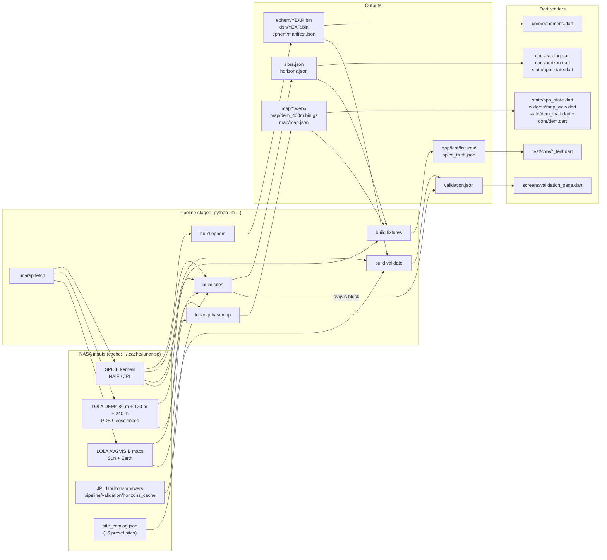

# The data pipeline

This folder holds the Python "precompute" for Lunar Horizon: the code that turns raw NASA data into the small files the app ships in `app/assets/data/`. It runs once, on a developer's computer; the app never runs it, and its results are committed, so nobody needs to run it to use or build the app. This page explains what goes in, what each step does and how long it takes, what comes out, how its accuracy is checked, and what every Python file is for.

For the app as a whole, see the main [README](../README.md). For every formula with its source line, see [formula.md](../formula.md).

## Contents

- [The big picture](#the-big-picture)
- [Raw inputs](#raw-inputs)
- [Stages](#stages)
- [Outputs](#outputs)
- [How accurate is it](#how-accurate-is-it)
- [Reproducible output](#reproducible-output)
- [Every Python file](#every-python-file)
  - [Library modules](#library-modules-pipelinelunarsp)
  - [Tests](#tests-pipelinetests)
  - [Blender, research and tools](#blender-research-and-tools)

## The big picture

The pipeline is the "kitchen" of Lunar Horizon. It runs once, on a developer's computer, and never on the phone or in the browser.
First it downloads raw NASA data: SPICE kernels and LOLA rasters. A **SPICE kernel** is a data file from NASA's NAIF team that tells software where the planets are, how the Moon is turned, and how clocks relate (leap seconds). A **DEM** (digital elevation model) is a map whose pixels hold terrain heights; LOLA is the laser altimeter on NASA's Lunar Reconnaissance Orbiter that measured them.
From these the pipeline computes small files that the app ships in `app/assets/data/` (about 9.6 MB in total): hourly Sun and Earth positions for 2025-2035, Deep Space Network (DSN) contact bits, the 16 preset sites with their horizon masks, map images, a coarse 400 m terrain file (80 m-derived to 80°S, 120 m-derived beyond, to about 75°S), and an accuracy report.
A **horizon mask** is the outline of the surrounding terrain seen from one spot: for each compass direction, how many degrees above level the skyline is.
The app then does the rest on the device: it combines these files to work out, for any date and site, when the Sun and Earth are above the skyline.
The pipeline also writes an "answer key" (`app/test/fixtures/spice_truth.json`) that the Dart tests check the app's maths against.
The generated files are committed to git, so a fresh clone of the app runs without the roughly 570 MB of downloads.

## Raw inputs

Everything here is listed in `pipeline/lunarsp/config.py`, with its web address, its exact size in bytes and its SHA-256 checksum (a fingerprint of the exact bytes). `python -m lunarsp.fetch` downloads them into the cache folder `$LUNAR_SP_CACHE` (default `~/.cache/lunar-sp`), kernels under `kernels/` and rasters under `dem/`. They are never put in the repository.

**SPICE kernels** (publisher: NASA NAIF at JPL, host `naif.jpl.nasa.gov`, folder `pub/naif/generic_kernels`). Sizes are the pinned byte counts from `config.py`. `pipeline/lunarsp/spice_env.py` loads all six together, so every step that uses SPICE needs all six on disk; the last column says which steps actually use each one.

| Key | File | What it is | Size | What needs it |
|---|---|---|---|---|
| `lsk` | `naif0012.tls` | Leap-second table, for converting UTC to SPICE time | 5,257 B (5 KB) | every step that uses SPICE |
| `pck` | `pck00011.tpc` | Planetary constants: body radii (Earth's shape for the DSN stations) and the `IAU_MOON` rotation, used only in the wrong-frame sensitivity check | 131,226 B (128 KB) | ephem (DSN), validate |
| `moon_fk` | `moon_de440_250416.tf` | Defines the `MOON_ME` and `MOON_PA` lunar frames | 19,478 B (19 KB) | every Moon-fixed calculation |
| `moon_bpc` | `moon_pa_de440_200625.bpc` | How the Moon is turned over time (DE440 libration) | 12,863,488 B (12.9 MB) | every Moon-fixed calculation |
| `spk` | `de440s.bsp` | DE440 ephemeris: positions of the Sun, Earth and Moon, 1849-2150 | 32,726,016 B (32.7 MB) | ephem, sites, validate, fixtures, render prep |
| `earth_bpc` | `earth_1962_260806_2126_combined.bpc` | Earth orientation in the ITRF93 frame (history plus prediction to 2126), for the DSN station positions | 31,318,016 B (31.3 MB) | ephem (DSN bits), DSN tests |

Two kernels (`moon_fk` and `earth_bpc`) have dates in their names. NAIF replaces such files and moves the old one to an `a_old_versions/` folder, so `config.py` lists that folder as a fallback address.

**Optional cross-check: DE442.** Key `spk442`, file `de442s.bsp`, 32,701,440 B (32.7 MB), same NAIF host. It is a newer JPL ephemeris used only to measure how much the answer would change (the `de440_vs_de442` block of `validation.json` and a test in `test_geometry.py`). It is never mixed into the shipped data. Get it with `python -m lunarsp.fetch extra`; without it, that check is skipped.

**LOLA rasters.** All are south-polar stereographic maps (pole in the centre, longitude 0 up, 90°E to the right).

| Key | File (as downloaded) | What it is | Size | Publisher and host | What needs it |
|---|---|---|---|---|---|
| `ldem_80s_80m` | `ldem_80s_80m.img` | Terrain heights, 80 m per pixel, 7600 × 7600 pixels, 80°S to the pole; height = value × 0.5 m above the 1737.4 km sphere | 115,520,000 B (115.5 MB) | NASA PDS Geosciences Node, `pds-geosciences.wustl.edu` (LRO LOLA GDR polar) | sites (near terrain), basemap (hillshade and the inner 80-90°S block of `dem_400m.bin.gz`), render prep, DEM tests |
| `ldem_75s_240m` | `ldem_75s_240m.img` | Terrain heights, 240 m per pixel, 3812 × 3812 pixels, 75°S to the pole | 29,062,688 B (29.1 MB) | same | sites and render prep (far terrain beyond the 80 m map), DEM tests |
| `ldem_75s_120m` | `ldem_75s_120m.img` | Terrain heights, 120 m per pixel, 7624 × 7624 pixels, 75°S to the pole (the square's corners hold real heights to about 69°S; the label has no missing-data value and the data hold no fill values) | 116,250,752 B (116.3 MB) | same | basemap (the ring of `dem_400m.bin.gz` beyond 80°S), DEM tests |
| `avgvis_sun` | `avgvisib_75s_120m_sun.img` (remote name `avgvisib_75s_120m_201608.img`) | The LOLA team's average Sun visibility map (Mazarico et al. 2011 method), 120 m per pixel, value × 0.00004 = fraction of time | 116,250,752 B (116.3 MB) | NASA PDS Geosciences Node, `pds-geosciences.wustl.edu` (`lro-l-lola-3-rdr-v1/lrolol_1xxx/extras/illumination/img`); the LOLA team's server `imbrium.mit.edu` (EXTRAS/ILLUMINATION/IMG) mirrors the same files | sites (independent cross-check), basemap (sunlight overlay and PSR layer, inner and outer) |
| `avgvis_earth` | `avgvisib_75s_120m_earth.img` (remote name `avgvisib_75s_120m_201608_earth.img`) | The same for Earth visibility | 116,250,752 B (116.3 MB) | same | sites (cross-check), basemap (Earth overlay, inner and outer) |

The production set (all six kernels and five rasters) adds up to about 570 MB; with DE442 it is about 603 MB. That matches the "about 570 MB (605 MB with DE442)" quoted in the README.

**Other inputs that are already in the repository:**
- `pipeline/lunarsp/site_catalog.json`: the 16 preset sites with their sources (made by `pipeline/research/make_catalog.py`).
- `pipeline/validation/horizons_cache/`: 48 saved answers from JPL Horizons (1,057,726 B, about 1.1 MB). See "How accurate is it".

## Stages

Run every command from `pipeline/` with the project's Python environment active, except the install, which runs from the repository root. Timings were measured on the development laptop (CPU only) during clean-clone runs.

| Stage | Command | Reads | Writes | Time |
|---|---|---|---|---|
| Install | `pip install -r pipeline/requirements.txt` | `requirements.txt` | the Python environment | about 2.5 min |
| fetch | `python -m lunarsp.fetch` (add `extra` for DE442, or name single keys such as `lsk moon_bpc`) | the web addresses in `config.py` | kernels and rasters in `$LUNAR_SP_CACHE` | network-bound; about 570 MB (605 MB with DE442) |
| basemap | `python -m lunarsp.basemap` | 80 m and 120 m DEMs, both AVGVISIB maps | `app/assets/data/map/`: `hillshade.webp`, `sunvis.webp`, `earthvis.webp`, `psr.webp`, `dem_400m.bin.gz`, the four `*_outer.webp`, `map.json` | 9-12 min |
| basemap, outer layers only | `python -m lunarsp.basemap outer` | 120 m DEM, both AVGVISIB maps, the tint levels already in `map.json` (`hillshade.tint`) | `hillshade_outer.webp`, `sunvis_outer.webp`, `earthvis_outer.webp`, `psr_outer.webp` and the `outer` entry of `map.json` only (every other file and key keeps its bytes) | about 45 s |
| basemap, DEM only | `python -m lunarsp.basemap dem` | 80 m and 120 m DEMs | `dem_400m.bin.gz` and the `dem` entry of `map.json` only (every other file and key keeps its bytes) | about 25 s |
| ephem | `python -m lunarsp.build ephem` | SPICE kernels | `ephem/<year>.bin`, `dsn/<year>.bin` and `ephem/manifest.json` for 2025-2035 | about 30 s |
| sites | `python -m lunarsp.build sites` | `site_catalog.json`, SPICE kernels, 80 m and 240 m DEMs, AVGVISIB maps | `sites.json`, `horizons.json`, and the `avgvis` block of `validation.json` | about 4.5-5 min |
| validate | `python -m lunarsp.build validate` | SPICE kernels, the shipped `ephem/` files, the Horizons cache, DE442 if present | `validation.json` (its own blocks; keeps `avgvis` and `render_skyline`) | about 20 s |
| fixtures | `python -m lunarsp.build fixtures` | SPICE kernels, `sites.json`, `horizons.json`, `map/map.json`, `map/dem_400m.bin.gz` | `app/test/fixtures/spice_truth.json` | about 5 s |
| fixtures, coarse horizons only | `python -m lunarsp.fixtures coarse` | `map/map.json`, `map/dem_400m.bin.gz` (no SPICE kernels) | the `coarseHorizon` key of `spice_truth.json` only | about 1 s |
| build all | `python -m lunarsp.build all` (also the default with no step) | all of the above | ephem, then sites, then validate, then fixtures | 5-6 min |
| curated | `python -m lunarsp.curated` (`--check` only compares) | `pipeline/research/site_overviews_verified.json`, `site_research_verified.json`, `app/assets/data/sites.json` | `app/assets/data/curated_sites.json` | under 1 s; needs no downloads |
| Horizons refresh | `python -m lunarsp.horizons --refresh` | JPL Horizons web service (`ssd.jpl.nasa.gov`) | `pipeline/validation/horizons_cache/*.json` | network-bound; only needed to re-query |
| tests | `python -m pytest` | everything above when present | nothing | about 1-3 min, 586 tests (585 pass, 1 skipped without PyYAML) |

What each stage does, in plain words:
- **fetch** downloads in parallel 2 MiB pieces (up to 24 connections), because NASA's servers slow each connection. A file appears under its real name only when complete; an interrupted download resumes. Complete files are skipped. Sizes are checked, and each fresh download is checked against its pinned SHA-256 checksum (a mismatch deletes it).
- **basemap** makes the map pictures and a coarse 400 m terrain file that the app uses to work out a horizon for any spot the user taps. It is not part of `build all`. Run it before `build fixtures`, which reads its output.
- **ephem** writes, for every hour from 2025-01-01 to 2036-01-01, where the Sun and Earth are as seen from the Moon's centre, plus one byte saying which DSN stations (Goldstone, Madrid, Canberra) see the Moon at least 10° up. The app adds the site's own position and interpolates between hours.
- **sites** computes each preset site's horizon mask at 2 m and 10 m observer heights, every 0.25° of azimuth, ignoring terrain closer than 120 m (the 80 m map cannot resolve it). It also computes long-term sunlight and Earth-view percentages and compares them with the LOLA team's maps.
- **validate** compares the pipeline and the app's own method against JPL Horizons and SPICE, and writes the accuracy report.
- **curated** turns the fact-checked site descriptions into the text of the app's *At a glance* card (called "glance" in the app's code and "curated" for this text, because "overview" already names a Site tab and a Blender step). It is not part of `build all` and needs no kernels or DEMs, so CI can check it. It fails if the text states a number the app computes (a %, hours of sunlight, a distance from the pole or a slope), repeats a claim the fact-check did not support, or cites a source that no verdict checked.
- **fixtures** writes the Dart test answer key. Its random seed is fixed, so the content is the same every run, apart from its time stamp.

**Optional: Blender renders (not shown in the app).** `python -m lunarsp.build renders` runs `render_prep`, then Blender 5.1 for each site (`pipeline/blender/render_site.py`), then `render_post`. It needs Blender 5.1 (set `BLENDER` if it is not at the default install path) and takes about 5 minutes per site on CPU (4096 × 683 pixels, ±30° band, 32 samples). It writes `app/assets/data/renders/` and the `render_skyline` block of `validation.json`. `python -m lunarsp.build overview` makes a 36-frame turntable of the whole region in the same way (`render_overview_prep`, `render_overview.py`, `render_overview_post`); `build.py` says both steps "take hours on CPU", and no separate timing was measured for `overview`. Neither is part of `build all`. The app no longer shows these images (a user decision on 2026-10-10); the site panoramas are kept only as an independent check of the horizon code. The app's pictures come from the computed light and shadow map instead.

## Outputs

Sizes were measured on the committed files on 2026-10-11. "Encoding" comes from the writer code. Every JSON file is written as UTF-8 with LF line endings (see "Reproducible output").

| File | Written by | Encoding | Size | Read by (Dart) |
|---|---|---|---|---|
| `app/assets/data/ephem/<year>.bin` (11 files, 2025-2035) | `ephemeris.py` | Little-endian float32, 6 numbers per hour (Sun x, y, z and Earth x, y, z in km from the Moon's centre, `MOON_ME` frame, `LT+S`) | 210,240 B (365-day year) or 210,816 B (2028, 2032) | `app/lib/core/ephemeris.dart` (file names come from the manifest) |
| `app/assets/data/dsn/<year>.bin` (11 files, 2025-2035) | `ephemeris.py` | One byte per hour; bit 0 Goldstone, bit 1 Madrid, bit 2 Canberra = Moon centre at least 10° up | 8,760 B or 8,784 B | `app/lib/core/ephemeris.dart` (via `dsnFile` in the manifest) |
| `app/assets/data/ephem/manifest.json` | `ephemeris.py` | JSON, indent 1: layout, kernels used, per-year file names, counts and checksums, `generatedUtc` | 3,607 B | `app/lib/core/ephemeris.dart` |
| `app/assets/data/sites.json` | `sites.py` | JSON, indent 1: the 16 sites with metadata, terrain height, slope, horizon summary and long-term %, plus groups and provenance | 31,333 B | `app/lib/core/catalog.dart`, `app/lib/state/app_state.dart`; tests `dem_horizon_test.dart`, `series_metrics_test.dart`, `series_sliced_test.dart`, `shadow_test.dart`, `light_engine_test.dart` |
| `app/assets/data/horizons.json` | `sites.py` | Compact JSON: horizon masks at 2 m and 10 m, 0.25° step, whole hundredths of a degree (centidegrees) | 242,114 B | `app/lib/core/catalog.dart`, `app/lib/core/horizon.dart`, `app/lib/state/app_state.dart`; same tests as `sites.json` |
| `app/assets/data/validation.json` | `validate.py`, plus the `avgvis` block from `sites.py` and the `render_skyline` block from `render_post.py` | JSON, indent 1 | 16,243 B | `app/lib/screens/validation_page.dart` loads it. `app/lib/content/how_calculated.dart` quotes its numbers as text (it does not load the file) |
| `app/assets/data/map/hillshade.webp` | `basemap.py` | WebP greyscale shaded relief, 320 m per pixel, quality 82 | 471,622 B | `app/lib/state/app_state.dart`, `widgets/map_view.dart`, `light_map.dart`, `light_snapshot.dart`, `terrain_thumb.dart` |
| `app/assets/data/map/sunvis.webp` | `basemap.py` | WebP RGBA tinted overlay of LOLA average Sun visibility, 480 m per pixel, quality 85 | 866,024 B | `app/lib/state/app_state.dart` (loaded by its key in `map.json`), `widgets/map_view.dart` |
| `app/assets/data/map/earthvis.webp` | `basemap.py` | WebP RGBA overlay of LOLA average Earth visibility, 480 m per pixel, quality 85 | 693,836 B | `app/lib/state/app_state.dart` (loaded by its key in `map.json`), `widgets/map_view.dart` |
| `app/assets/data/map/psr.webp` | `basemap.py` | WebP RGBA: permanently shadowed regions (average Sun visibility = 0), 480 m per pixel, quality 90 | 108,998 B | `app/lib/state/app_state.dart` (loaded by its key in `map.json`), `widgets/map_view.dart` |
| `app/assets/data/map/hillshade_outer.webp` | `basemap.py` | WebP RGBA shaded relief out to 75°S: 1900 × 1900 px at 480 m (±456 km), LDEM_75S_120M 4 × 4 block means, the inner relief's lighting and tint (zNorm from `hillshade.tint` zLowM / zHighM); alpha 0 on the pixels wholly inside ±300 km, quality 82 | 304,564 B | the app's Explore map past 80°S (loaded lazily) |
| `app/assets/data/map/sunvis_outer.webp`, `earthvis_outer.webp`, `psr_outer.webp` | `basemap.py` | WebP RGBA overlays out to 75°S: 950 × 950 px at 960 m (±456 km), 8 × 8 block means of the central 7600 px of the 120 m AVGVISIB maps, the inner layers' colour and alpha mapping; alpha 0 wholly inside ±300 km; quality 85 / 85 / 90 | 285,360 B; 191,952 B; 37,616 B | the app's Explore map past 80°S (loaded lazily) |
| `app/assets/data/map/dem_400m.bin.gz` | `basemap.py` | 2280 × 2280 int16 heights at 400 m per pixel (±456 km, to about 75.05°S on the axes): the inner 1520 × 1520 block (80-90°S) is the 5 × 5 block mean of LDEM_80S_80M, unchanged since before the ring was added; the ring beyond it is the exact-overlap area mean of LDEM_75S_120M. "planar-split" (each value stored as its difference from a prediction, low bytes then high bytes) and gzip | 4,694,460 B | `app/lib/state/app_state.dart` (file name from the `dem` block of `map.json`), decoded by `decodeDem` in `app/lib/state/dem_load.dart` with `PolarGrid.decodePlanarSplit` in `app/lib/core/dem.dart`; tests `dem_horizon_test.dart`, `shadow_test.dart`, `light_engine_test.dart` |
| `app/assets/data/map/map.json` | `basemap.py` | JSON, indent 1: map extent of the image layers (`halfWidthM`, 304 km), each layer's file, pixel size and source; the DEM's own size and extent (`dem.halfWidthM`, 456 km), encoding, inner block, ring method and measured seam statistics; `outer`: the outer layers' extent (`halfWidthM` 456 km, `blankHalfWidthM` 300 km), files, pixel sizes and sources | 3,587 B | `app/lib/state/app_state.dart`; tests `dem_horizon_test.dart`, `shadow_test.dart`, `light_engine_test.dart` |
| `app/assets/data/curated_sites.json` | `curated.py` | JSON, indent 1, sorted keys, no time stamp: per preset a headline, a lede (whole leading sentences, at most 230 characters), the overview and its sources (`titled: false` when only the host name is known), plus the IAU feature centres with their diameters | 33,873 B | `app/lib/core/curated.dart`, loaded by `app/lib/state/app_state.dart` |
| `app/test/fixtures/spice_truth.json` | `fixtures.py` | Compact JSON: 1000 SPICE az/el cases, 64 visible-fraction cases (40 random + 24 fixed cases across the 0/360° seam), coarse horizons at 3 sites on the 400 m DEM, and 30-day hourly series at 2 sites | 933,217 B | `app/test/core/spice_truth_test.dart`, `dem_horizon_test.dart`, `series_metrics_test.dart` (also checked by `pipeline/tests/test_visibility.py`) |
| `app/assets/data/renders/` (70 files: 16 sites × `best.webp` + `night.webp`, `manifest.json`, and `overview/` with 36 `frame_XX.webp` + `overview.json`) | `render_post.py`, `render_overview_post.py` | WebP images and JSON | 2,269,943 B in total (site images 9,622-30,384 B each; frames 28,162-61,358 B) | **Not bundled and not read.** `app/pubspec.yaml` lists only `assets/data/`, `ephem/`, `dsn/` and `map/`, and Flutter does not include sub-folders that are not listed, so `renders/` is left out of the app |

The bundled files (everything except `renders/`) add up to 9,574,858 bytes, the "about 9.6 MB" in the README.

## How accurate is it

Unless stated otherwise, the numbers below are read from `app/assets/data/validation.json` (stamped 2026-10-10T10:18:52Z). Angles are in arcminutes (′); one arcminute is 1/60 of a degree, and the Sun's disk is about 32′ across.

**1. The pipeline against JPL Horizons (`horizons` block).** JPL Horizons is NASA JPL's own public ephemeris service, an independent answer key. `python -m lunarsp.horizons` asked it for the airless apparent azimuth, elevation and distance of the Sun and of Earth, seen from 8 points on the Moon (the near-pole point, a ridge at 1.5 km height, Malapert at 5 km, Nobile, de Gerlache, Mouton, a point at 80°S and Haworth), in three 30-day windows (March 2025, July-August 2028, October 2035) at 4-hour steps. That is 8 × 3 × 2 = 48 queries, saved in `pipeline/validation/horizons_cache/`, so the check runs offline. Horizons used DE441 and its MEAN_ME frame. Over 4344 samples per body, the largest difference is 1.82e-5′ for the Sun and 3.83e-5′ for Earth.

**2. The app's own method against Horizons (`app_vs_horizons`).** This uses exactly what the app does: the shipped float32 hourly file, 4-point interpolation, and the site offset. Worst case 1.27e-4′ for the Sun and **0.0016′ (1.61e-3′) for Earth**. This is the "app vs Horizons worst 0.0016 arcmin" figure quoted elsewhere in the docs; its source is `validation.json` → `app_vs_horizons.earth.maxArcmin` (0.0016122), also in formula.md §13.3 and §13.10.

**3. The app's method against SPICE (`app_vs_spice`).** 2000 random sites between 80°S and 90°S and random dates in 2025-2035: worst 1.28e-4′ (Sun) and 1.62e-3′ (Earth). The largest relative distance error is 6.22e-8 (Sun) and 1.33e-7 (Earth).

**4. The check would catch a wrong frame (`frame_sensitivity`).** Repeating check 1 in the wrong lunar frame gives up to 1.73′ (`MOON_PA`) or 0.198′ (`IAU_MOON`), far above the real errors. So the check is sensitive.

**5. DE440 against DE442 (`de440_vs_de442`).** At 759 times in 2025-2035, the Sun's direction from the Moon's centre changes by at most 4.59e-7′ and Earth's by at most 2.93e-6′ between the two JPL ephemerides. This needs the optional DE442 download; without it the block is skipped.

**6. The horizon code on a smooth sphere (`horizon_dip`).** On a featureless 1737.4 km sphere, the computed horizon matches the exact formula arccos(R / (R + h)) to 5.39e-6′ (h = 2 m), 3.76e-6′ (10 m), 2.67e-6′ (1000 m) and 1.85e-5′ (5000 m).

**7. Sunlight against the LOLA team's maps (`avgvis`, written by the `sites` step).** For each preset site, the pipeline counts how often any part of the Sun (or Earth) is above its horizon, hourly over 18.6 years from 2009-01-01, for an observer on the surface. It compares that with the LOLA AVGVISIB maps, which the LOLA team made independently.
- 11 region-type sites: Sun differs by 1.78 percentage points on average (4.62 at most), Earth by 2.02 (14.86 at most); 21 of 22 values fall inside LOLA's own 3 × 3-pixel range (±0.5 points).
- 5 exact ridge and peak points: Sun 7.33 on average (20.3 at most), Earth 2.84 (7.17 at most); 9 of 10 inside the range. These points sit on terrain smaller than one map pixel, which is why the app offers 2 m and 10 m heights and labels its fidelity.

**8. Blender skyline (`render_skyline`, written by `render_post.py`, stamped 2026-10-09T15:57:43Z).** A ray-traced skyline from Blender agrees with the 2 m horizon masks at 16 sites × 4096 columns (0.0878° per pixel): mean of site means 0.0392°, worst 95th percentile 0.090°, worst maximum 0.1749°.

**9. The Dart answer key (`app/test/fixtures/spice_truth.json`).** `app/test/core/spice_truth_test.dart` requires the app's Dart code to reproduce the 1000 SPICE sky positions to within 0.01′ in direction and 1e-6 in relative distance, and the 64 visible-fraction cases to within 1e-9. The pipeline test `pipeline/tests/test_visibility.py` checks the same file from the Python side.

**10. Light and shadow map (these numbers are not in `validation.json`).** The test "shadow map vs ray-marched horizons at 16 sites x 60 moments" in `app/test/core/shadow_test.dart` makes 960 checks (16 preset sites × 60 random moments, seed 7, in the 360 days from 2026-10-09). Each compares "sunlit or not" at the site's map pixel with the result from that site's 2 m horizon mask. The figures are recorded in [formula.md](../formula.md) §12.9 (and §13.11) and in the main [README](../README.md):

| Map grid | Agreement with 400 m on-device horizons | Agreement with 80 m preset horizons |
|---|---|---|
| 400 m (site close-up) | 94.4 % | 87.4 % |
| 800 m (whole region) | 90.8 % | 82.4 % |

The test fails below 90 % and 80 % on the 400 m grid, and below 75 % for the 800 m grid against the 80 m horizons.

**Where to find more.** [formula.md](../formula.md) §13 has every check with its formula and source line; §13.10 is the error budget for directions. The pytest suite repeats many checks with pass/fail limits (for example, under 0.01′ against Horizons in `test_horizons_validation.py`) and prints the measured errors as a list at the end of the run (`pipeline/tests/conftest.py`).

## Reproducible output

Two helpers in `pipeline/lunarsp/outio.py` make a rerun produce the same bytes as the committed files:
- **`write_json`** writes JSON as UTF-8 with LF (Unix) line endings on every system. Python's usual text writer turns line breaks into CRLF on Windows, so before this helper a regenerated file never matched the committed one. Every `lunarsp` module that writes a JSON output uses it. The two exceptions are not outputs of the build: `fetch.py`'s small download-progress note in the cache, and `pipeline/research/make_catalog.py`, which writes `site_catalog.json` with `write_text` (the repository's `.gitattributes` turns it back into LF when it is committed). `pipeline/tests/test_outputs_deterministic.py` checks that no `lunarsp` module except `fetch.py` writes JSON with `write_text`, and that none except `outio.py` stamps the clock time directly.
- **`utc_stamp`** makes the `generatedUtc` time stamp. If the standard `SOURCE_DATE_EPOCH` variable is set (a Unix time in whole seconds), it uses that time instead of the clock. So two runs with the same inputs and the same value give byte-identical files.

To keep a committed file's stamp unchanged, set `SOURCE_DATE_EPOCH` to the time already stamped in it. The committed files carry different stamps, so run those steps one at a time, each with its own value. PowerShell: `$env:SOURCE_DATE_EPOCH = "<seconds>"`; Git Bash, macOS and Linux: `export SOURCE_DATE_EPOCH=<seconds>`.

`map.json` has no time stamp; its `dem` block is written by the same `build_dem` code in a full `lunarsp.basemap` run and in the DEM-only step. The binary files (`ephem`, `dsn`, `dem_400m.bin.gz`) have no stamp either; the gzip header of the committed `dem_400m.bin.gz` holds a zero time, not a date.

## Every Python file

Each file below has one entry, in the same shape: what it does, what it reads, what it writes, who uses it, and how to run it.

### Library modules (`pipeline/lunarsp/`)

The Python package lives in `pipeline/lunarsp/`. Every file is listed below, grouped by job. SPICE kernels, DEMs and horizon masks are explained in [The big picture](#the-big-picture); the pipeline reads SPICE kernels with the `spiceypy` library. A few more words come up often:

- **Ephemeris:** a table of where bodies are at each moment. Here it means the hourly Sun and Earth positions seen from the Moon.
- **Azimuth / elevation:** compass direction (clockwise from north) and height above the level horizon, in degrees.
- **DSN:** NASA's Deep Space Network, the three big dish sites (Goldstone, Madrid, Canberra) that talk to spacecraft.

The test counts below are what `python -m pytest --collect-only` collects at this commit (586 in total). "Needs kernels" or "needs DEMs" means those tests are skipped, not failed, on a fresh clone that has not run `python -m lunarsp.fetch`.

#### Setup and downloads

##### `pipeline/lunarsp/__init__.py`
- **What it does:** Marks the folder as the Python package `lunarsp`, so its files can be run as `python -m lunarsp.<name>`. It holds only a one-line description and no logic.
- **Reads:** nothing.
- **Writes:** nothing.
- **Used by:** Python, whenever any `lunarsp` module is imported or run.
- **Run it:** not run directly.

##### `pipeline/lunarsp/config.py`
- **What it does:** The one settings file. It fixes what the pipeline computes and where every file lives, so all science choices can be checked in one place.
- **Reads:** the `LUNAR_SP_CACHE` environment variable (default `~/.cache/lunar-sp`).
- **Writes:** nothing; it is a library. It defines:
  - Folders: the download cache (`kernels/` and `dem/` inside it), `app/assets/data/`, `app/test/fixtures/` and `pipeline/validation/horizons_cache/`.
  - Six production SPICE kernels, each with web address, pinned size and pinned SHA-256 checksum: leap seconds (`naif0012.tls`), planetary constants (`pck00011.tpc`), the Moon frame definitions (`moon_de440_250416.tf`), Moon orientation (`moon_pa_de440_200625.bpc`), the DE440 ephemeris (`de440s.bsp`) and ITRF93 Earth orientation for the DSN check (`earth_1962_260806_2126_combined.bpc`). Two dated NAIF files also list a backup address in NAIF's `a_old_versions/` folder.
  - DE442 (`de442s.bsp`), kept apart and used only for a cross-check.
  - Four LOLA rasters: the 80 m and 240 m south-pole terrain maps, and the LOLA team's average Sun and Earth visibility maps (used only as cross-checks and map overlays), with each raster's size, metres per pixel and value scale.
  - The time span (2025-01-01 up to 2036-01-01, one sample per hour), the `MOON_ME` frame and `LT+S` corrections (light travel time and aberration, so positions are where the bodies appear).
  - Constants: Moon sphere 1737.4 km, Sun radius 695,700 km, Earth radius 6378.1366 km, 1 au, and 1361 W/m² at 1 au.
  - Horizon settings: 2 m and 10 m observer heights, one value every 0.25° of azimuth, terrain closer than 120 m ignored.
  - The three DSN dish positions (DSS-14, DSS-63, DSS-43) and the 10° elevation threshold.
- **Used by:** almost every other file in the package, and most test files.
- **Run it:** not run directly.

##### `pipeline/lunarsp/fetch.py`
- **What it does:** Downloads the SPICE kernels and LOLA maps into the cache: about 570 MB, or 605 MB with DE442. NASA's servers are slow per connection, so big files are fetched as many 2 MiB pieces at once (up to 24 connections). Each file is built in a `.part` file and only gets its real name when complete; a small side file records finished pieces so an interrupted download resumes. Files already present are skipped, sizes are checked, and a new download whose SHA-256 checksum does not match the pinned one is deleted.
- **Reads:** the file list in `config.py`; the NAIF and PDS web servers (the LOLA DEMs and the AVGVISIB maps both come from the PDS Geosciences Node).
- **Writes:** `$LUNAR_SP_CACHE/kernels/` and `$LUNAR_SP_CACHE/dem/` (never the repo).
- **Used by:** you, before any build step. `spice_env.py` and `dem.py` tell you to run it when a file is missing or unfinished. Tested by `pipeline/tests/test_fetch.py` (18 tests, offline, no network: the web is faked): an interrupted download never appears under its final name, mirrors are tried on a 404, size and checksum mismatches are refused, HTML error pages are refused, damaged progress files restart instead of skipping data, and every remote file has a pinned size and checksum.
- **Run it:** `python -m lunarsp.fetch` (kernels and maps). Add `extra` for DE442. `kernels` or `dems` fetch one group; a config key such as `lsk` fetches one file.

##### `pipeline/lunarsp/outio.py`
- **What it does:** A small helper that makes reruns produce byte-identical files. `write_json` always writes UTF-8 with Unix (LF) line endings, also on Windows. `utc_stamp` makes the `generatedUtc` time stamp, and uses the standard `SOURCE_DATE_EPOCH` variable instead of the clock when it is set.
- **Reads:** the `SOURCE_DATE_EPOCH` environment variable.
- **Writes:** nothing; it is a library.
- **Used by:** every file that writes JSON: `ephemeris.py`, `sites.py`, `basemap.py`, `horizons.py`, `validate.py`, `fixtures.py` and the four `render_*` files. Tested by `pipeline/tests/test_outputs_deterministic.py` (7 tests, offline): LF endings, no writer bypasses `write_json` or reads the clock directly, `SOURCE_DATE_EPOCH` is honoured, the `build` command line rejects bad options, and the Horizons query settings stay pinned.
- **Run it:** not run directly.

##### `pipeline/lunarsp/build.py`
- **What it does:** The main command. `all` (also the default) runs four steps in order: `ephem`, `sites`, `validate`, `fixtures`. You can also name single steps. Two Blender steps, `renders` and `overview`, are never part of `all`.
- **Reads:** the step modules below; for the Blender steps, Blender 5.1 (from `$BLENDER` or the default Windows install path) and the scripts in `pipeline/blender/`.
- **Writes:** whatever each step writes (see the entries below). Blender logs go next to the render inputs in the cache.
- **Used by:** you. `pipeline/tests/test_outputs_deterministic.py` checks its option parsing (a missing value is a clear error; `all` can be mixed with other steps).
- **Run it:** `python -m lunarsp.build all` takes about 5-6 minutes on the dev laptop (ephem about 30 s, sites about 4.5-5 min, validate about 20 s, fixtures about 5 s). Needs the downloads, the cached Horizons replies, and the map files from `basemap.py` (for `fixtures`). Blender: `python -m lunarsp.build renders [--force] [--sites a,b] [--res 4096] [--samples 32]` and `python -m lunarsp.build overview [--force]`. `basemap` and `horizons` are run on their own, not through this file.

#### Sky geometry (SPICE)

##### `pipeline/lunarsp/spice_env.py`
- **What it does:** Loads the SPICE kernels into memory once per run and converts between clock systems: UTC, Unix time (what the app uses) and SPICE's ephemeris time (ET). `kernel_set("spk442")` swaps in DE442 for a cross-check and always swaps DE440 back afterwards. If a kernel is missing, it stops and tells you to run `python -m lunarsp.fetch`.
- **Reads:** the six production kernels (and DE442 when asked) from `$LUNAR_SP_CACHE/kernels/`.
- **Writes:** nothing; it is a library.
- **Used by:** `geometry.py`, `ephemeris.py`, `sites.py`, `validate.py`, `fixtures.py`, `render_prep.py`, `render_overview_prep.py`. Tested by `pipeline/tests/test_spice_env.py` (11 tests, needs kernels; the swap test also needs DE442): time conversions match SPICE, the 2016 leap second is handled, the DE442 swap puts DE440 back afterwards, a failed swap leaves the normal kernels working, and the DSN check uses ITRF93.
- **Run it:** not run directly.

##### `pipeline/lunarsp/geometry.py`
- **What it does:** Works out where the Sun and Earth appear in a site's sky (azimuth and elevation). It has two independent methods. The "gold standard" (`reference_azel`) asks SPICE for the view from the surface point directly. The app's method (`center_vectors` then `topo_azel_from_center`) takes positions seen from the Moon's centre and subtracts the site's own position. It also builds the local east-north-up directions (north means away from the pole) and measures the angle between two sky directions in arcminutes (1 arcminute is 1/60 of a degree).
- **Reads:** SPICE, through `spice_env.py`; settings from `config.py`.
- **Writes:** nothing; it is a library.
- **Used by:** `ephemeris.py`, `horizon.py`, `sites.py`, `appmodel.py`, `validate.py`, `fixtures.py`, `render_prep.py`, `render_overview_prep.py`. Tested by `pipeline/tests/test_geometry.py` (174 tests, most of them the same check repeated over many sites and directions; 5 test functions need kernels and one also needs DE442): the direction conventions hold everywhere including exactly at the pole, and the two methods agree with each other and with SPICE's own `azlcpo` routine.
- **Run it:** not run directly.

##### `pipeline/lunarsp/visibility.py`
- **What it does:** Works out how much of the Sun's or Earth's disk is above a jagged horizon. It cuts the disk into 16 vertical strips and compares each strip with the horizon at its own azimuth. It also gives each disk's apparent size and the power proxy: 1361 W/m² × (1 au / distance)² × visible fraction, for a panel facing the Sun.
- **Reads:** settings from `config.py`.
- **Writes:** nothing; it is a library.
- **Used by:** `sites.py`, `fixtures.py`, `render_prep.py`, `render_post.py`, `render_overview_prep.py`. The app's `app/lib/core/visibility.dart` mirrors it and must match it to 1e-9 (checked through `fixtures.py`). Tested by `pipeline/tests/test_visibility.py` (31 tests; one needs kernels): a straight horizon matches the exact circular-segment formula, results stay between 0 and 1, the 0°/360° seam is handled, disk sizes and power are right, and the shipped Dart answer key still matches this code.
- **Run it:** not run directly.

#### Terrain (LOLA)

##### `pipeline/lunarsp/dem.py`
- **What it does:** Opens the LOLA south-pole maps and converts between latitude/longitude and map pixels. The map projection puts the pole in the centre, longitude 0 straight up and 90°E to the right. Heights come out in metres (stored value × 0.5). `TerrainModel` uses the 80 m map first and falls back to the 240 m map where the 80 m map has no data. It refuses to open a half-finished download.
- **Reads:** the LOLA files in `$LUNAR_SP_CACHE/dem/` (read in place, not loaded whole into memory).
- **Writes:** nothing; it is a library.
- **Used by:** `horizon.py`, `sites.py`, `basemap.py`, `fixtures.py`, `render_prep.py`, `render_overview_prep.py`, `pipeline/tests/test_fetch.py`. Tested by `pipeline/tests/test_dem_projection.py` (27 tests; the real-terrain ones need the 80 m and/or 240 m DEMs): map conversions round-trip, and the map is the right way up, checked on terrain that cannot be mistaken (Shackleton crater's floor versus its mirror point, and Mons Mouton above 5 km).
- **Run it:** not run directly.

##### `pipeline/lunarsp/horizon.py`
- **What it does:** Computes a site's horizon mask. For each azimuth it walks outward along the surface and keeps the highest terrain angle, using an exact formula that includes the Moon's curvature. Steps are 10 m from 120 m out to 20 km, then grow by 0.1% each out to 600 km. Terrain closer than 120 m is ignored because the 80 m map cannot resolve it. Against a 1 m-step reference at the 8 preset sites tested, this makes the horizon too low by 0.2 arcminutes on average and about 4.3 arcminutes at worst. It also gives the local ground slope.
- **Reads:** terrain through `dem.py`.
- **Writes:** nothing; it is a library.
- **Used by:** `sites.py` (preset horizons), `validate.py` (smooth-sphere check), `fixtures.py` (a coarser step plan that must match `app/lib/core/horizon_compute.dart`). Tested by `pipeline/tests/test_horizon.py` (28 tests; 2 test functions need both DEMs): exact answers on made-up terrain (flat sphere, ring, wall, single peak), a taller observer never sees a higher horizon, and the 10 m step has converged on real terrain.
- **Run it:** not run directly.

#### Products the app ships

##### `pipeline/lunarsp/ephemeris.py`
- **What it does:** Writes the hourly Sun and Earth positions and the DSN contact bits that let the app answer any hour from 2025 through 2035 offline. Positions are apparent (`LT+S`), in km from the Moon's centre, in the `MOON_ME` frame; the app subtracts the site position and interpolates between hours. A DSN bit is set when the Moon's centre is at least 10° up at that dish site, using ITRF93 Earth orientation.
- **Reads:** SPICE kernels through `spice_env.py` and `geometry.py`.
- **Writes:** in `app/assets/data/`:
  - `ephem/<year>.bin`, one per year 2025-2035: six 32-bit numbers per hour (Sun x, y, z and Earth x, y, z).
  - `dsn/<year>.bin`: one byte per hour; bit 0 Goldstone, bit 1 Madrid, bit 2 Canberra.
  - `ephem/manifest.json`: the layout, the kernels used, a checksum per year and other provenance.
- **Used by:** `build.py` (step `ephem`). In the app, `app/lib/core/ephemeris.dart` reads all three. In Python, `appmodel.py` reads the manifest and the hourly position files (not the DSN files). Tested by `pipeline/tests/test_ephemeris_files.py` (10 tests; 4 need kernels; all skip if the manifest is missing): file sizes, checksums and hourly spacing are right, values are physically sensible, and samples and DSN bits match a fresh SPICE calculation. `pipeline/tests/test_dsn_geometry.py` (4 tests, needs kernels) recomputes the Moon's elevation at each dish by a different SPICE route, from published station positions, and checks each bit belongs to the right station.
- **Run it:** `python -m lunarsp.build ephem` (about 30 s).

##### `pipeline/lunarsp/site_catalog.json`
- **What it does:** The hand-curated list of 16 preset landing sites, each with its source. There are three groups: 8 Artemis III candidate regions (approximate region centres, not official landing points), 5 high-sunlight points from De Rosa et al. 2012, and 3 mission sites. Each site records its kind (9 approximate region centres, 5 exact points, 2 landed positions), a confidence level, latitude and longitude, citations and notes. The file also records when and how the research was done.
- **Reads:** nothing (it is data).
- **Writes:** nothing.
- **Used by:** `sites.py`, which copies its metadata into `app/assets/data/sites.json`. `pipeline/tests/test_data_provenance.py` checks that the shipped notes match it and are not written in the first person.
- **Run it:** not run (edit it by hand, then rerun `python -m lunarsp.build sites`).

##### `pipeline/lunarsp/sites.py`
- **What it does:** Builds the preset site list and each site's horizon masks, and checks the results against the LOLA team's own sunlight maps. For each site it computes horizons at 2 m and 10 m (plus a surface one used only for the check). It also works out long-term figures at 2 m height: % of time any part of the Sun is up, % for Earth and % for both, over 18.6 years of hourly samples from 2009.
- **Reads:** `site_catalog.json`, the LOLA DEMs and (if downloaded) the average-visibility maps, and SPICE.
- **Writes:**
  - `app/assets/data/sites.json`: site metadata plus terrain height, slope, highest and mean horizon, and the long-term percentages.
  - `app/assets/data/horizons.json`: the masks, every 0.25°, stored as whole hundredths of a degree.
  - the `avgvis` section of `app/assets/data/validation.json`. At this commit: for the 11 region-type sites the Sun figure differs from LOLA's map by 1.78 percentage points on average (4.62 at most), and 21 of 22 values fall inside LOLA's own 3×3-pixel range. The 5 exact ridge and peak points differ more (Sun 7.33 points on average, 20.3 at most), because the 80 m map cannot resolve their fine terrain.
- **Used by:** `build.py` (step `sites`). In the app, `app/lib/state/app_state.dart` loads both files, `app/lib/core/catalog.dart` parses them and `app/lib/core/horizon.dart` decodes the masks. In Python, `fixtures.py` and `render_prep.py` read both files, and `render_overview_prep.py` reads `sites.json`. `pipeline/tests/test_data_provenance.py` (12 tests, offline) checks the `avgvis` summary text is computed from the rows.
- **Run it:** `python -m lunarsp.build sites` (about 4.5-5 minutes).

##### `pipeline/lunarsp/basemap.py`
- **What it does:** Makes the map images and the coarse terrain file behind the app's map and custom-site feature. The images cover the 80 m map's square (304 km from the pole to each edge, 80°S on the axes). The 400 m terrain file reaches further, 456 km from the pole (about 75°S on the axes), so the light & shadow close-up of a site near 80°S (IM-1 Odysseus at 80.13°S) has terrain on every side. The four outer layers cover that same 456 km square, coarser on purpose, so the Explore map can zoom out to 75°S.
- **Reads:** the 80 m and 120 m LOLA DEMs and the two LOLA average-visibility maps.
- **Writes:** in `app/assets/data/map/`:
  - `hillshade.webp`: shaded relief at 320 m per pixel. The light direction is a display choice, not a Sun position, and is recorded in `map.json`.
  - `sunvis.webp` and `earthvis.webp`: LOLA's average Sun and Earth visibility as tinted overlays, 480 m per pixel.
  - `psr.webp`: permanently shadowed regions (average Sun visibility is zero).
  - `hillshade_outer.webp`, `sunvis_outer.webp`, `earthvis_outer.webp`, `psr_outer.webp`: the same four layers out to 75°S, over the whole ±456 km square. The relief is 1900 px at 480 m (LDEM_75S_120M 4 × 4 block means, pixel edges on the pole-centred 120 m grid) with the inner relief's lighting and tint, its zNorm taken from `hillshade.tint` zLowM / zHighM so the tones match. The overlays are 950 px at 960 m (8 × 8 block means of the central 7600 px of the 7624 px AVGVISIB maps) with the inner overlays' colour and alpha mapping. Pixels wholly inside ±300 km get alpha 0 (they keep their colour, so the lossy encoder does not bleed a dark edge into the data next to them); real data reach 4 km inside the inner layers' ±304 km edge, so no gap shows along 80°S. Measured over that overlap band (`tests/test_outer_layers.py`): overlay alpha against the inner overlays' 2 × 2 means, mean |difference| 0.78 (Sun), 0.80 (Earth), 0.37 (PSR) alpha levels, correlation ≥ 0.997; relief against the inner relief on common 960 m blocks, mean |difference| 1.8 grey levels, correlation 0.997. Decoded in memory they take about 14.4 MB (relief) + 3 × 3.6 MB (overlays); the app loads them only when a view reaches past the ±304 km square.
  - `dem_400m.bin.gz`: heights at 400 m per pixel, 2280 × 2280, packed with a small lossless scheme ("planar-split" plus gzip). The inner 1520 × 1520 block (80-90°S) is the 5 × 5 block mean of the 80 m DEM, byte-identical to the file shipped before the ring was added. The ring beyond 80°S comes from LDEM_75S_120M: each 400 m cell is the mean of the 120 m pixels weighted by the area each one covers in the cell (exact overlaps; 3 cells per 10 pixels, weights 1, 1, 1, 1/3 | 2/3, 1, 1, 2/3 | 1/3, 1, 1, 1). The build refuses fill values, records the seam check (120 m-derived minus 80 m-derived heights over the inner block's outer 5 px: mean 0.03 m, standard deviation 0.95 m, 99th percentile 3.0 m, max 18.5 m) in `map.json`, and checks the file decodes back exactly. The app uses it to compute a horizon for any point you tap and for the light & shadow map; both are coarser than the presets and labelled so.
  - `map.json`: extents, settings and sources.
- **Used by:** you; it is not part of `build all`. In the app, `app/lib/state/app_state.dart` loads the files, and `app/lib/widgets/map_view.dart`, `light_map.dart`, `light_snapshot.dart` and `terrain_thumb.dart` draw them. The Dart tests `app/test/core/dem_horizon_test.dart`, `app/test/core/shadow_test.dart` and `app/test/state/light_engine_test.dart` read `map.json` and `dem_400m.bin.gz`, and so does `fixtures.py`. `pipeline/tests/test_data_provenance.py` checks `map.json` records the hillshade settings the code uses.
- **Run it:** `python -m lunarsp.basemap` (9-12 minutes on the dev laptop). Run it before `build fixtures`. `python -m lunarsp.basemap dem` rebuilds only `dem_400m.bin.gz` and the `dem` entry of `map.json` (about 25 s; needs only the 80 m and 120 m DEMs), then `python -m lunarsp.fixtures coarse` refreshes the coarse-horizon answer key. `python -m lunarsp.basemap outer` (about 45 s; needs the 120 m DEM and both AVGVISIB maps) rewrites only the four `*_outer.webp` files and the `outer` entry of `map.json`, taking the tint levels from `map.json`; `pipeline/tests/test_outer_layers.py` checks that it reproduces the shipped files and touches nothing else.

#### Checks

##### `pipeline/lunarsp/horizons.py`
- **What it does:** Asks NASA JPL's Horizons web service, an independent source, where the Sun and Earth appear from 8 lunar test sites, with no refraction. It covers three 30-day windows (March 2025, July-August 2028, October 2035) at 4-hour steps: 48 queries in all. Replies are saved so tests and validation run offline; saved queries are not fetched again unless you add `--refresh`.
- **Reads:** the Horizons web API (network needed only to fill or refresh the cache).
- **Writes:** `pipeline/validation/horizons_cache/*.json` (48 files, committed).
- **Used by:** `validate.py` reads the cache. Tested by `pipeline/tests/test_horizons_validation.py` (194 tests, most need kernels): the cache covers all 48 queries and is well formed, the pipeline matches every reply to within 0.01 arcminute in `MOON_ME`, and the same check fails if a wrong Moon frame (`MOON_PA` or `IAU_MOON`) is used, which proves the test can catch a frame mistake.
- **Run it:** `python -m lunarsp.horizons --refresh` (needs network).

##### `pipeline/lunarsp/appmodel.py`
- **What it does:** A Python copy of the app's own calculation, so the accuracy report measures exactly what the app displays. It reads the shipped hourly files, interpolates with the same 4-point method as `app/lib/core/ephemeris.dart`, and applies the same site offset and directions as the app's geometry code.
- **Reads:** `app/assets/data/ephem/manifest.json` and the `ephem/<year>.bin` files.
- **Writes:** nothing; it is a library.
- **Used by:** `validate.py` only. No test file imports it directly; its results are the `app_vs_horizons` and `app_vs_spice` numbers in `validation.json`.
- **Run it:** not run directly.

##### `pipeline/lunarsp/validate.py`
- **What it does:** Writes the accuracy report the app shows. All errors are angles on the sky in arcminutes. At this commit:
  - SPICE pipeline vs JPL Horizons: at most 0.00004.
  - The app's method vs Horizons: at most 0.0016 (Earth).
  - The same comparison with a wrong Moon frame: off by up to 1.73 (`MOON_PA`) or 0.20 (`IAU_MOON`), showing the check would catch it.
  - The app's method vs SPICE at 2000 random sites and times per body.
  - DE440 vs DE442 (skipped if DE442 was not downloaded).
  - Horizon of a perfectly smooth sphere vs the exact formula.
- **Reads:** the shipped ephemeris (through `appmodel.py`), the Horizons cache, SPICE kernels (DE442 if present), `horizon.py`.
- **Writes:** `app/assets/data/validation.json`. It keeps the sections other steps wrote: `avgvis` from `sites.py` and `render_skyline` from `render_post.py`.
- **Used by:** `build.py` (step `validate`). In the app, `app/lib/screens/validation_page.dart` reads the file and `app/lib/content/how_calculated.dart` quotes its numbers. `pipeline/tests/test_validation_report.py` (2 tests, offline) checks the other steps' sections are kept.
- **Run it:** `python -m lunarsp.build validate` (about 20 s).

##### `pipeline/lunarsp/fixtures.py`
- **What it does:** Writes the "answer key" that the app's Dart tests must reproduce. It has 1000 Sun/Earth sky positions straight from SPICE at random south-polar sites and times, including edge cases such as the exact pole and a year boundary (Dart must match to 0.01 arcminute). It has 64 visible-fraction cases on made-up horizons, 24 of them straddling the 0°/360° seam (Dart must match to 1e-9). It has reference horizons at 3 sites on the shipped 400 m terrain file, and 30 days of hourly positions and fractions at two preset sites. The random seed is fixed, so every run gives the same cases (only the time stamp changes, unless `SOURCE_DATE_EPOCH` is set).
- **Reads:** SPICE; `app/assets/data/sites.json` and `horizons.json` (from `sites.py`); `app/assets/data/map/map.json` and `dem_400m.bin.gz` (from `basemap.py`).
- **Writes:** `app/test/fixtures/spice_truth.json`.
- **Used by:** `build.py` (step `fixtures`). Read by the Dart tests `app/test/core/spice_truth_test.dart`, `dem_horizon_test.dart` and `series_metrics_test.dart`, and by the Python tests `test_visibility.py` and `test_data_provenance.py`.
- **Run it:** `python -m lunarsp.build fixtures` (about 5 s). After a new `dem_400m.bin.gz`, `python -m lunarsp.fixtures coarse` rewrites only the coarse horizons (`coarseHorizon`) and needs no SPICE kernels; every other key keeps its bytes.

##### `pipeline/lunarsp/curated.py`
- **What it does:** Builds the text of the app's *At a glance* card for the 16 preset sites from the committed research record. It checks that the ids match `sites.json`, that each headline is one short sentence, that no text states a computed number (Rule C: `%`, hours or days of sunlight, a distance in km or degrees from the pole, a slope in degrees), that no claim marked unsupported survives, that every source is https, unique and cited by a checked verdict, and that every logged edit adds no new word of four or more letters and no new number. Each lede is the overview's leading whole sentences, at most 230 characters. Source titles come from `sites.json`, then the research file, else the host name; titles are never invented. Features are the IAU Gazetteer centres, with the diameter when the Gazetteer states one.
- **Reads:** `pipeline/research/site_overviews_verified.json`, `pipeline/research/site_research_verified.json`, `app/assets/data/sites.json`.
- **Writes:** `app/assets/data/curated_sites.json` through `outio.write_json` (no time stamp, so a rebuild is byte-identical).
- **Used by:** you; it is not part of `build all`. In the app, `app/lib/core/curated.dart` parses the file and `app/lib/core/site_glance.dart` uses it.
- **Run it:** `python -m lunarsp.curated` (under 1 s, no downloads). `python -m lunarsp.curated --check` exits 1 if the shipped file is out of date.

#### Blender cross-check (not shown in the app)

The app no longer shows Blender renders. They are kept only as an independent check: Blender draws each site's skyline by ray tracing the same terrain, and the result is compared with the horizon masks. The Blender scripts themselves are `pipeline/blender/render_site.py` and `render_overview.py`. All four files below need Blender output or Blender inputs and are run only through `build renders` or `build overview`.

##### `pipeline/lunarsp/render_prep.py`
- **What it does:** Prepares Blender's 360° view of each preset site. It builds a terrain mesh around the site (1440 directions, from 120 m out to 300 km, 20 m steps to 2 km then growing) with the same maps and curvature as the horizon code. It picks two real moments in the year from 2026-10-09: "best", inside the longest window with both Sun and Earth up, and "night", the middle of the longest time with no Sun.
- **Reads:** `app/assets/data/sites.json` and `horizons.json`, the LOLA DEMs, SPICE.
- **Writes:** `$LUNAR_SP_CACHE/renders/<siteId>/mesh_f32.bin` and `scene.json` (cache only, not the repo).
- **Used by:** `build.py` (step `renders`); its output is read by `pipeline/blender/render_site.py` and `render_post.py`. Tested with `render_post.py` by `pipeline/tests/test_render_prep.py` (10 tests, offline): mesh spacing and shape, and the choice of the two moments.
- **Run it:** `python -m lunarsp.render_prep [siteId ...]`, normally through `python -m lunarsp.build renders`.

##### `pipeline/lunarsp/render_post.py`
- **What it does:** Turns Blender's panoramas into web images, turned so north is in the centre, and measures Blender's skyline against the 2 m horizon masks. At this commit, over 16 sites, the average difference is 0.04° and the worst is 0.17°.
- **Reads:** Blender output in `$LUNAR_SP_CACHE/renders/<siteId>/out/` (`<key>.png`, `mask.png`, `render_meta.json`), `scene.json`, `app/assets/data/horizons.json`.
- **Writes:** `app/assets/data/renders/<siteId>/best.webp` and `night.webp`, `app/assets/data/renders/manifest.json`, and the `render_skyline` section of `app/assets/data/validation.json`. The `renders/` folder is not in the app's bundled assets list (`app/pubspec.yaml`).
- **Used by:** `build.py` (step `renders`). `app/lib/screens/validation_page.dart` shows the `render_skyline` section. Tested by `pipeline/tests/test_render_prep.py` (image orientation and skyline statistics).
- **Run it:** `python -m lunarsp.render_post [siteId ...]`, normally through `python -m lunarsp.build renders`. The Blender run inside that step is the slow part: about 5 minutes per site on CPU.

##### `pipeline/lunarsp/render_overview_prep.py`
- **What it does:** Prepares a rotating 3D overview of the whole region from 80°S to the pole, with pins for the preset sites. The terrain is the 80 m map averaged to 640 m, with true curvature and heights exaggerated 3×, lit by the real Sun at 2026-10-09.
- **Reads:** the 80 m LOLA DEM, `app/assets/data/sites.json`, SPICE.
- **Writes:** `$LUNAR_SP_CACHE/renders/overview/grid_f32.bin` and `overview_scene.json`.
- **Used by:** `build.py` (step `overview`); read by `pipeline/blender/render_overview.py` and `render_overview_post.py`. No test file.
- **Run it:** `python -m lunarsp.render_overview_prep`, normally through `python -m lunarsp.build overview`.

##### `pipeline/lunarsp/render_overview_post.py`
- **What it does:** Converts the 36 Blender overview frames into compressed images and records where each pin appears on screen in each frame, and whether terrain hides it.
- **Reads:** `$LUNAR_SP_CACHE/renders/overview/` (`frame_XX.png`, `pins_raw.json`, `overview_scene.json`).
- **Writes:** `app/assets/data/renders/overview/frame_XX.webp` and `overview.json`. Nothing in the app reads them.
- **Used by:** `build.py` (step `overview`). No test file.
- **Run it:** `python -m lunarsp.render_overview_post [--quality 82]`, normally through `python -m lunarsp.build overview`.

### Tests (`pipeline/tests/`)

The tests check each piece of the pipeline against something independent of it: exact formulas, SPICE's own routines, saved answers from NASA JPL Horizons, published station positions and the real LOLA terrain. Errors are given in arcminutes (′), as in [How accurate is it](#how-accurate-is-it); here "DEMs" means LOLA's 80 m and 240 m south-pole terrain maps.

The kernels and DEMs are about 570 MB of downloads that live in the cache (`~/.cache/lunar-sp`, or `$LUNAR_SP_CACHE`), never in the repository. A test that needs them is **skipped** on a fresh copy instead of failing. Tests that need only the committed data (`app/assets/data/`, `app/test/fixtures/`, `pipeline/validation/horizons_cache/`) always run.

Run all of them from `pipeline/` with `python -m pytest` (`pipeline/pytest.ini` points pytest at `tests/`). It collects **586 tests**. With all data downloaded, 585 pass and 1 is skipped when PyYAML is not installed. A full run takes about 1-3 minutes on the development laptop. The `pipeline` job in `.github/workflows/ci.yml` runs `python -m pytest -q` on every push to `main` and every pull request, without the downloads. To run one file, use `python -m pytest tests/<file>.py`.

The counts below are the number of tests pytest collects from each file. Where a test is "parametrized" (run once per input from a list), the count is larger than the number of test functions.

The files are listed in pipeline order: shared setup, download, time and geometry, terrain, horizons and visibility, the shipped ephemeris and DSN files, the shipped site and map data, the JPL check, output writing, the Blender cross-check and repository tools.

#### Shared setup

##### `pipeline/tests/__init__.py`
- **What it does:** An empty file. It makes the tests folder a Python package, so test files can import the shared helpers (`from tests._support import ...`).
- **Reads:** nothing.
- **Writes:** nothing.
- **Used by:** pytest and every test file.
- **Run it:** not run directly.

##### `pipeline/tests/_support.py`
- **What it does:** Shared helpers. It checks which downloads are present and defines "skip this test if missing" markers: `requires_kernels`, `requires_de442`, `requires_dem80`, `requires_dem240`, `requires_dem120` and `requires_avgvis` (both AVGVISIB maps). A DEM only counts when it is complete: its size must be exactly N × N × 2 bytes and no unfinished-download marker may sit next to it. It also provides `record`, `record_max` and `record_min`, which store measured errors (in arcminutes, metres, degrees and so on) and print them.
- **Reads:** `lunarsp/config.py` (where each kernel and DEM should be), and checks whether those files exist in the cache.
- **Writes:** nothing; it is a library. Measured errors are kept in memory in its `METRICS` table.
- **Used by:** almost every test file, and `conftest.py`.
- **Run it:** not run directly.

##### `pipeline/tests/conftest.py`
- **What it does:** pytest loads this file automatically. At the end of a run it prints a "measured errors / validation statistics" table with every number saved by `record` (if any were saved), so you see the accuracy figures without extra flags.
- **Reads:** the `METRICS` table in `_support.py`.
- **Writes:** nothing to disk; it prints to the terminal.
- **Used by:** pytest.
- **Run it:** not run directly.

#### Download

##### `pipeline/tests/test_fetch.py`
- **What it does:** Protects the downloader (`lunarsp/fetch.py`) without touching the network or the real cache. A fake server can serve pieces of a file, cut off a download partway, send an HTML error page or leave out the file size. The tests prove that an interrupted download never appears under its final name and can resume, that only missing pieces are fetched again, and that an untrustworthy progress file makes the download start over. They also prove that a 404 falls back to the backup address, and that a wrong size, a wrong SHA-256 checksum or an HTML page is rejected. Finally they check that every remote file has a pinned size and checksum, and that NAIF's dated kernels have backup addresses in NAIF's archive of old versions.
- **Reads:** `lunarsp/fetch.py`, `lunarsp/config.py`, `lunarsp/dem.py`; temporary folders only.
- **Writes:** only temporary test folders.
- **Used by:** pytest, CI.
- **Run it:** `python -m pytest tests/test_fetch.py`. 18 tests (15 functions, one run with 4 inputs). Needs no downloads.

#### Time and sky geometry

##### `pipeline/tests/test_spice_env.py`
- **What it does:** Protects the time conversions between the app's clock (UTC, Unix time) and SPICE's clock (ephemeris time, ET). Conversions must match SPICE's own to 1 microsecond and convert back cleanly. The 2016 leap second must add exactly 2 s of ET across one Unix second. ET minus UTC must be 69.184 s in 2025. Swapping to the DE442 cross-check kernel and back must restore the normal DE440 kernel, and a failed swap must leave the normal kernels usable. The DSN settings must use the ITRF93 Earth orientation.
- **Reads:** `lunarsp/spice_env.py`, `lunarsp/geometry.py`, `lunarsp/config.py`, `lunarsp/ephemeris.py`, and the SPICE kernels.
- **Writes:** nothing.
- **Used by:** pytest, CI (where it skips).
- **Run it:** `python -m pytest tests/test_spice_env.py`. 11 tests (6 functions, one run on 6 dates). All need the kernels. The swap test also needs DE442 (`python -m lunarsp.fetch extra`).

##### `pipeline/tests/test_geometry.py`
- **What it does:** Protects the sky-direction maths: the local east/north/up axes, azimuth and elevation. It checks the axes at many sites, including exactly at the pole, where "north" is the site's own meridian. Azimuth must run clockwise from north. With the kernels, it compares three independent ways of finding the Sun and Earth: the pipeline's reference method, SPICE's own `azlcpo` routine, and the app's method (Moon-centre vector minus the site). The app's method must agree within 0.01′. If DE442 is present, it also measures how far DE440 and DE442 directions differ.
- **Reads:** `lunarsp/geometry.py`, `lunarsp/config.py`, `lunarsp/spice_env.py`, and the kernels for the cross-checks.
- **Writes:** nothing.
- **Used by:** pytest, CI.
- **Run it:** `python -m pytest tests/test_geometry.py`. 174 tests (15 functions, most run on grids of latitudes and longitudes). 166 are pure maths; 8 need the kernels, and 1 of those also needs DE442.

#### Terrain maps

##### `pipeline/tests/test_dem_projection.py`
- **What it does:** Protects the LOLA polar map projection and terrain lookup, and proves the maps are the right way up (longitude 0 up, 90°E right). Pure-maths tests check that converting latitude/longitude to map x/y and back returns the start point, the pole sits at the centre, pixel centres follow NASA's PDS convention, blending of nearby pixels is exact on a tilted plane, and lookups outside the map return "no data". With the real maps, it checks orientation using features that cannot be confused: Shackleton's floor (below −2 km) against its mirror point across the 0/180° line (above 0), and Mons Mouton (above 5 km). It also checks that the 80 m and 240 m maps agree and that the code falls back to the coarse map outside the fine one.
- **Reads:** `lunarsp/dem.py`, `lunarsp/config.py`; a tiny made-up map in a temporary folder; the real DEMs when present.
- **Writes:** only temporary test folders.
- **Used by:** pytest, CI.
- **Run it:** `python -m pytest tests/test_dem_projection.py`. 27 tests (19 functions). 21 run anywhere; 6 need the DEMs (3 need the 80 m map, 1 the 240 m map and 2 both).

#### Horizons and visibility

##### `pipeline/tests/test_dem400.py`
- **What it does:** Protects the app's 400 m terrain file. The resampler that turns the 120 m DEM into 400 m cells must match an independent brute-force reference (each pixel copied onto a 40 m grid, then plain block means), keep constants constant, conserve the sum over every 1.2 km period, and refuse grids that do not line up and any fill value. The assembly must paste the inner block unchanged, and the planar-split encoding must round-trip at the full 2280 px. On the shipped file (no downloads needed): the size and extents agree with `map.json`, the inner 1520 × 1520 block has the SHA-256 and sum of the file shipped before the ring was added, the recorded seam statistics are within tolerance (mean below 0.5 m, standard deviation below 2 m, 99th percentile below 6 m, max below 40 m), and steps across 80°S look like the steps either side. With the DEMs: the inner block equals a fresh 80 m-only build, the ring equals a fresh 120 m rebuild, and the seam statistics recomputed from both DEMs equal those in `map.json`.
- **Reads:** `lunarsp/basemap.py`, `lunarsp/dem.py`, `lunarsp/config.py`; `app/assets/data/map/map.json` and `dem_400m.bin.gz`; the 80 m and 120 m DEMs when present.
- **Writes:** nothing.
- **Used by:** pytest, CI.
- **Run it:** `python -m pytest tests/test_dem400.py`. 24 tests (21 functions). 21 run anywhere; 3 need the DEMs (1 the 80 m map, 1 the 120 m map and 1 both; about 30 s with both).

##### `pipeline/tests/test_horizon.py`
- **What it does:** Protects the horizon calculation (`lunarsp/horizon.py`), which walks outward from a site in every direction and keeps the highest terrain angle. It uses made-up terrain where the true answer is an exact formula: a smooth sphere, a ring of hills, a long straight wall and a single peak. For example, on a smooth sphere the horizon must dip below level by about √(2h/R). It also checks that a taller observer never sees a higher horizon, that peaks appear at the right compass direction (at the pole and away from it), that slope is computed correctly and that a site off the map is an error. With the real DEMs, it runs a check at the Connecting Ridge and proves the 10 m step size is fine enough: halving it changes the horizon by less than 0.5′ on average.
- **Reads:** `lunarsp/horizon.py`, `lunarsp/dem.py`, `lunarsp/geometry.py`, `lunarsp/config.py`; the real DEMs for the last tests.
- **Writes:** nothing.
- **Used by:** pytest, CI.
- **Run it:** `python -m pytest tests/test_horizon.py`. 28 tests (14 functions). 24 use made-up terrain; 4 need both DEMs.

##### `pipeline/tests/test_visibility.py`
- **What it does:** Protects the maths for how much of the Sun's or Earth's disk is above the horizon mask, and the solar power estimate. The 16-strip method must match the exact area of a disk cut by a straight or tilted line, to within 0.5% of the disk. The result must stay between 0 and 1, must not fall as the body rises, and must work for a disk that straddles north (0/360°). It also checks horizon lookup between mask samples, the Sun's and Earth's apparent sizes, and the power formula 1361 W/m² × (1 au / r)² × visible fraction. Finally it checks the Dart test answer key (`app/test/fixtures/spice_truth.json`): its visible fractions must be reproduced to 12 decimal places, and every 20th of its Sun and Earth directions must match fresh SPICE.
- **Reads:** `lunarsp/visibility.py`, `lunarsp/geometry.py`, `lunarsp/config.py`, `app/test/fixtures/spice_truth.json`, and the kernels for one test.
- **Writes:** nothing.
- **Used by:** pytest, CI.
- **Run it:** `python -m pytest tests/test_visibility.py`. 31 tests (15 functions). 2 use the committed answer-key file (skipped if it is missing); 1 of those needs the kernels.

#### The shipped ephemeris and DSN files

##### `pipeline/tests/test_ephemeris_files.py`
- **What it does:** Protects the hourly Sun and Earth position files and the DSN files the app ships (`app/assets/data/ephem/` and `dsn/`). It checks the manifest's header, the size of each year file, that years 2025-2035 follow each other hour by hour with no gaps, and each file's SHA-256 checksum (the manifest stores its first 16 characters). Decoded positions must be physically sensible, each station's bit must be on for between 20% and 80% of hours, and at least one station must see the Moon in over 80% of hours. With the kernels, stored samples must match fresh SPICE, sample 0 must be exactly midnight UTC, and the DSN bits must match a fresh calculation. It also proves that hourly samples plus the app's interpolation stay within 0.01′ of SPICE.
- **Reads:** `app/assets/data/ephem/manifest.json`, `ephem/<year>.bin`, `dsn/<year>.bin`; `lunarsp/config.py`, `lunarsp/geometry.py`, `lunarsp/ephemeris.py`, `lunarsp/spice_env.py`; the kernels for 4 tests.
- **Writes:** nothing.
- **Used by:** pytest, CI.
- **Run it:** `python -m pytest tests/test_ephemeris_files.py`. 10 tests. 6 run on the committed files alone; 4 need the kernels. The whole file is skipped if the manifest has not been generated.

##### `pipeline/tests/test_dsn_geometry.py`
- **What it does:** Proves that the shipped DSN bits really mean "the Moon's centre is at least 10° up at Goldstone, Madrid or Canberra". It recomputes the Moon's elevation at 600 random hours by a separate SPICE route (`azlcpo`, at each station, with ITRF93 Earth orientation). The station positions come from NASA's DSN document 810-005, not from the project's own settings. Elevations must agree within 1.5 arcseconds, each bit must match, and each bit must belong to the right station. It also proves the test is sensitive: switching to the less accurate IAU_EARTH model must move the elevations by more than 150 arcseconds.
- **Reads:** `lunarsp/ephemeris.py`, `lunarsp/config.py`, `lunarsp/spice_env.py`, and the kernels.
- **Writes:** nothing.
- **Used by:** pytest, CI (where it skips).
- **Run it:** `python -m pytest tests/test_dsn_geometry.py`. 4 tests, all needing the kernels.

#### The shipped site and map data

##### `pipeline/tests/test_data_provenance.py`
- **What it does:** Checks that the notes and recorded settings in the shipped data match the code that made them. The kernel note must name ITRF93 for the DSN, and the ephemeris manifest must carry the same kernel notes as the settings file. `map.json` must record the exact hillshade light direction, height and tint the basemap code uses, and the light must come from the correct side. The sentence in `validation.json` that compares sites with LOLA's average Sun and Earth visibility maps must use the numbers from its own table. Site notes must be written neutrally (no "I", "we" or "our") and must match the site catalogue. The answer key must contain the special cases where the Sun's or Earth's disk straddles north (0/360°), and those cases must give the same answer when everything is turned 180°.
- **Reads:** `app/assets/data/ephem/manifest.json`, `map/map.json`, `validation.json`, `sites.json`; `pipeline/lunarsp/site_catalog.json`; `app/test/fixtures/spice_truth.json`; `lunarsp/config.py`, `basemap.py`, `sites.py`, `fixtures.py`, `visibility.py`.
- **Writes:** nothing.
- **Used by:** pytest, CI.
- **Run it:** `python -m pytest tests/test_data_provenance.py`. 12 tests. Needs no downloads; it reads only committed files.

#### The check against NASA JPL Horizons

##### `pipeline/tests/test_horizons_validation.py`
- **What it does:** Proves that the pipeline's Sun and Earth directions match NASA JPL Horizons (an independent NASA service) to better than 0.01′, using saved Horizons answers. It first checks that the saved answers are complete: 48 queries (8 sites × 3 date windows × Sun and Earth), each well formed, with nothing missing or extra. With the kernels, it recomputes every saved moment and requires agreement within 0.01′ and within 50 m in distance. To prove the test can tell lunar frames apart, it shows the wrong frames would fail: MOON_PA by more than 1′ and IAU_MOON by more than 0.05′. It records the median, 99th-percentile and largest differences.
- **Reads:** `pipeline/validation/horizons_cache/*.json` (48 files), `lunarsp/horizons.py`, `lunarsp/geometry.py`, `lunarsp/spice_env.py`, `lunarsp/config.py`, and the kernels. No network.
- **Writes:** nothing.
- **Used by:** pytest, CI.
- **Run it:** `python -m pytest tests/test_horizons_validation.py`. 194 tests (6 functions, four of them run once per saved file). 49 check the saved files and run anywhere; 145 need the kernels.

##### `pipeline/tests/test_validation_report.py`
- **What it does:** Proves that the `validate` step does not wipe out the parts of `validation.json` written by other steps. It must replace only its own sections and keep `avgvis` (from the `sites` step) and `render_skyline` (from the Blender cross-check), in order. It must also work when the file does not exist yet.
- **Reads:** `lunarsp/validate.py`; a made-up file in a temporary folder.
- **Writes:** only temporary test folders.
- **Used by:** pytest, CI.
- **Run it:** `python -m pytest tests/test_validation_report.py`. 2 tests. Needs no downloads.

#### Writing outputs and running the steps

##### `pipeline/tests/test_outer_layers.py`
- **What it does:** Protects the Explore map's outer layers out to 75°S (`*_outer.webp`, map.json `outer`). Geometry: 1900 px at 480 m and 950 px at 960 m over ±456 km (75.05°S on the axes; the inner ±304 km edge is 6 m south of 80°S), the blank square symmetric and wholly inside ±300 km with at least 2 whole outer pixels (4 km) of data inside ±304 km, and the window helper refusing misaligned grids and fill values. The colour/alpha/tint helpers must give exactly the values of the inline code they replaced. On the shipped files (no downloads needed): the `outer` entry and image sizes, alpha 0 inside and an opaque relief outside (tint floor held by all but 1e-4 of the pixels; lossy WebP moves isolated pixels near shadow edges by up to about 20 levels, as in the inner relief), data on both sides of 80°S, the overlays against the inner overlays over the overlap band (alpha mean |difference| < 6 levels, correlation > 0.95, a flipped layer fails, the layer colour within 12 levels where alpha ≥ 64), the relief against the inner relief on common 960 m blocks, and the orientation (Earth up on the near side; Shackleton's floor permanently shadowed, its left-right and up-down mirror points not). With the downloads, `python -m lunarsp.basemap outer` must reproduce the shipped `map.json` byte for byte and the images' alpha exactly, and write no other file.
- **Reads:** `lunarsp/basemap.py`, `lunarsp/dem.py`; `app/assets/data/map/` (the inner and outer layers, `map.json`); the 120 m DEM and both AVGVISIB maps when present.
- **Writes:** nothing (the rebuild test writes to a temporary folder).
- **Used by:** pytest, CI.
- **Run it:** `python -m pytest tests/test_outer_layers.py`. 15 tests (12 functions). 14 run anywhere; 1 needs the 120 m DEM and both AVGVISIB maps (about 50 s).

##### `pipeline/tests/test_outputs_deterministic.py`
- **What it does:** Proves that rerunning the pipeline gives byte-identical files. JSON must be written with Unix line endings, even on Windows. A scan of every `lunarsp` module checks that none writes JSON another way and none stamps the current time directly. The timestamp must follow `SOURCE_DATE_EPOCH` when it is set. It also checks the `build` command line (a missing value is a clear error, and `all` works inside a list of steps), and that the Horizons query settings stay fixed so the saved answers stay valid.
- **Reads:** `lunarsp/outio.py`, `lunarsp/build.py`, `lunarsp/horizons.py`, and the source text of every `lunarsp/*.py` file.
- **Writes:** only temporary test folders.
- **Used by:** pytest, CI.
- **Run it:** `python -m pytest tests/test_outputs_deterministic.py`. 7 tests. Needs no downloads.

##### `pipeline/tests/test_curated.py`
- **What it does:** Checks the *At a glance* text: the shipped `curated_sites.json` equals a fresh build byte for byte; all 16 ids once; each Rule C pattern rejects and accepts a sample, and the known clashes are caught before their logged edits; no unsupported claim remains; ledes are prefixes of their overviews that end in '.' and stay within 230 characters; titles are never invented; Shackleton's diameter is 20.92 km and a feature without a stated diameter gets null.
- **Reads:** `pipeline/research/site_overviews_verified.json`, `site_research_verified.json`, `app/assets/data/sites.json` and `curated_sites.json`.
- **Writes:** nothing.
- **Used by:** pytest, CI.
- **Run it:** `python -m pytest tests/test_curated.py`. 38 tests. Needs no downloads.

#### The Blender cross-check

##### `pipeline/tests/test_render_prep.py`
- **What it does:** Tests the code before and after the Blender site panoramas, which the app no longer shows but which still give an independent skyline check. The terrain mesh rings must run from 120 m in 20 m steps to 2 km, then grow by 0.4% per ring out to 300 km. A flat mesh must follow the Moon's curvature and keep its rays in compass order. It also checks the site height offset, the filling of missing data, the choice of "best" and "night" moments, the turning of images so north is in the middle, and the skyline statistics.
- **Reads:** `lunarsp/render_prep.py`, `lunarsp/render_post.py`; made-up terrain and images only.
- **Writes:** nothing.
- **Used by:** pytest, CI.
- **Run it:** `python -m pytest tests/test_render_prep.py`. 10 tests (7 functions, one run with 4 inputs). Needs no downloads and no Blender.

#### Repository tools

##### `pipeline/tests/test_check_formula_refs.py`
- **What it does:** Proves that `tools/check_formula_refs.py` catches broken code references in `formula.md`. It builds a tiny fake repository in a temporary folder and runs the checker on it. Correct references must pass. A missing file, a file name found in two folders, a line number past the end of a file and a function name that no longer exists must all fail. With `--no-symbols`, the renamed-function case passes again.
- **Reads:** `tools/check_formula_refs.py`; the fake repository.
- **Writes:** only temporary test folders.
- **Used by:** pytest, CI.
- **Run it:** `python -m pytest tests/test_check_formula_refs.py`. 4 tests. Needs no downloads.

##### `pipeline/tests/test_repo_hygiene.py`
- **What it does:** Checks the GitHub Actions settings and the icon script. `tools/check_workflows.py` must pass on the real `.github/workflows/` folder. On made-up workflow files it must flag old or unreviewed action versions, references it cannot check, and missing or wrong "cancel older runs" settings. The real `ci.yml` must cancel superseded runs, and `deploy-pages.yml` must not. `tools/make_icons.py preview` must create its output folder and three preview images.
- **Reads:** `tools/check_workflows.py`, `tools/make_icons.py`, `.github/workflows/ci.yml` and `deploy-pages.yml`.
- **Writes:** only temporary test folders.
- **Used by:** pytest, CI.
- **Run it:** `python -m pytest tests/test_repo_hygiene.py`. 14 tests (7 functions, one run with 8 inputs). Needs no downloads. The `ci.yml` check is skipped if PyYAML is not installed (it is not in `pipeline/requirements.txt`); this is the one skipped test in a full local run. The icon test is skipped if Pillow is missing.

### Blender, research and tools

#### Blender scripts (optional; the app does not show their images)

These two scripts run inside Blender 5.1 (its own bundled Python, with `bpy` and numpy), never in the pipeline's Python environment. Lighting is physical: a Sun lamp with the real brightness and disk size from SPICE, grey terrain (albedo 0.12), a black sky and no stars or textures.

##### `pipeline/blender/render_site.py`
- **What it does:** Renders the 360° view a 2 m observer would see at one preset site, using Cycles on the CPU, for each moment chosen by `render_prep` (one in the best Sun-and-Earth window, one in the longest night). Earth is a plain sphere lit by the same Sun, so its phase is right; earthshine is a weak second lamp. Two visualisation aids are labelled in `render_meta.json`: a fill light the camera cannot see (`--fill`, default 3.0; 0 means purely physical light) and an unlit slate fan for the ground nearer than 120 m, which the 80 m DEM cannot resolve.
- **Reads:** `scene.json` and `mesh_f32.bin` written by `lunarsp/render_prep.py` into `$LUNAR_SP_CACHE/renders/<siteId>/` (local east-north-up metres).
- **Writes:** in the `--out` folder: one RGBA PNG per moment, `mask.png` (terrain coverage only, used for the skyline check) and `render_meta.json` (image size, the verified pixel-to-azimuth/elevation mapping, samples, exposure, render time). Before rendering it places three markers at known directions, finds them in a test image and stops if the mapping error is over 0.5°. `--make-synthetic DIR` instead writes a test scene with a 600 m cone hill 8 km east of the site.
- **Used by:** `lunarsp/build.py` (step `renders`), which runs it once per site; `lunarsp/render_post.py` then turns its output into WebP files and the `render_skyline` block of `validation.json`. No test imports it (it needs Blender); `pipeline/tests/test_render_prep.py` tests the Python code before and after it.
- **Run it:** normally `python -m lunarsp.build renders` (from `pipeline/`; about 5 min per site on CPU). Directly: `blender -b --factory-startup -P pipeline/blender/render_site.py -- --scene <scene.json> --out <dir> [--res 3072] [--samples 32] [--exposure EV] [--band 30] [--fill 3] [--calibrate] [--no-denoise]`. `build renders` passes `--res 4096 --samples 32`; the script's own default resolution is 3072. See [blender/README.md](blender/README.md).

##### `pipeline/blender/render_overview.py`
- **What it does:** Renders a 36-frame turntable of the whole region from 80°S to the pole, with glowing cones (not to scale) marking the preset sites. The camera sits 35° above the horizontal, 1350 km away, and turns 10° per frame. It is not part of the skyline cross-check.
- **Reads:** `grid_f32.bin` and `overview_scene.json` from `lunarsp/render_overview_prep.py`, in `$LUNAR_SP_CACHE/renders/overview/` (km around the pole; 640 m grid with 3× height exaggeration, made by the prep step).
- **Writes:** `frame_XX.png` (00-35) and `pins_raw.json` (each pin's position on screen in each frame, and whether terrain hides it) in the same folder. `lunarsp/render_overview_post.py` turns these into `app/assets/data/renders/overview/frame_XX.webp` and `overview.json`, which nothing in the app reads.
- **Used by:** `lunarsp/build.py` (step `overview`: prep, then this script, then post). No test uses it.
- **Run it:** normally `python -m lunarsp.build overview [--force]` (from `pipeline/`). Directly: `blender -b --factory-startup -P pipeline/blender/render_overview.py -- [--frames 0,9,18] [--res 1280x800] [--samples 64] [--dir <overview dir>]`.

#### Site research

##### `pipeline/research/site_research_verified.json`
- **What it is:** The fact-checked research behind the preset sites (retrieved 2026-10-09). It holds 83 candidate entries in three families: Artemis III candidate regions (18), high-illumination points from the literature (55) and mission sites (10). Each entry has an id, name, latitude, east-positive longitude, coordinate kind, confidence, sources (title, web address and what the source says) and notes. Each family also has the fact-checker's summary: what was re-checked, what was corrected and what could not be verified. Its `method` field records how it was made: three parallel web-research agents, each followed by an independent fact-check agent that re-opened the sources, fixed conventions and dropped unsourced values.
- **Reads:** nothing; it is data.
- **Writes:** nothing.
- **Used by:** `pipeline/research/make_catalog.py`, and `lunarsp/curated.py` for source titles and the IAU feature centres.
- **Run it:** not run; it is data.

##### `pipeline/research/site_overviews_verified.json`
- **What it is:** The fact-checked descriptions behind the app's *At a glance* card (reviewed 2026-10-25): for each of the 16 preset sites a headline, an overview, its source URLs, the claim-by-claim verdicts (`confirmed`, `corrected` or `unsupported`, each with its source) and the editorial `edits` (`was`, `now`, `why`) that removed computed numbers such as distances from the pole. It is the only hand-edited input of `curated.py`; a second reader should review each logged edit.
- **Reads:** nothing; it is data.
- **Writes:** nothing.
- **Used by:** `lunarsp/curated.py` and `tests/test_curated.py`.
- **Run it:** not run; it is data. Rerun `python -m lunarsp.curated` after editing it.

##### `pipeline/research/make_catalog.py`
- **What it does:** Picks the 16 preset sites from the research file and writes the catalogue the pipeline uses. They come in three groups: 8 Artemis III candidate-region centres (approximate centres, not official landing points; Slater Plain is left out because no centre coordinates were published), 5 high-illumination points from De Rosa et al. 2012, and 3 mission sites (IM-1 and IM-2 as landed, and the VIPER mission area). Coordinates are copied exactly, with each site's name, short label, coordinate kind, confidence, sources and notes.
- **Reads:** `pipeline/research/site_research_verified.json`.
- **Writes:** `pipeline/lunarsp/site_catalog.json`. It uses `Path.write_text`, not the pipeline's `outio.write_json`, so on Windows it writes CRLF line endings (the repository's `.gitattributes` turns them back into LF when the file is committed).
- **Used by:** run by hand. Its output is read by `lunarsp/sites.py`, which builds the app's `sites.json` and `horizons.json`. No test runs it.
- **Run it:** `python research/make_catalog.py` (from `pipeline/`).

#### Repository tools

##### `tools/check_formula_refs.py`
- **What it does:** Checks that every code reference such as `name.ext:12-34` in formula.md (or another Markdown file) still points at real code. Each file name must match exactly one file under `app/lib`, `app/test`, `pipeline/lunarsp`, `pipeline/tests`, `pipeline/blender`, `charts/src`, `docs` or the repository root (formula.md §0.6 settles names that exist in more than one place). Each cited line range must lie inside the file, and each function or variable name written in backticks must still exist in the code. It never writes into the repository and needs only the Python standard library.
- **Reads:** the Markdown file (default `formula.md`) and the code files it cites.
- **Writes:** nothing; it prints one `doc:line: message` line per problem and exits with 1 if there are any.
- **Used by:** developers keeping formula.md accurate. `pipeline/tests/test_check_formula_refs.py` tests it on a small fake repository in a temporary folder (so CI runs the tests of the checker, not the checker on the real formula.md).
- **Run it:** `python tools/check_formula_refs.py [--doc README.md] [--show N] [--warn] [--no-symbols]` (from the repository root). `--show N` prints the cited lines, `--warn` adds rough hints that never fail, and `--no-symbols` skips the name check.

##### `tools/check_workflows.py`
- **What it does:** Checks the GitHub Actions files in `.github/workflows/`. Every `uses:` step (except local `./` actions) must name a reviewed action at a minimum major version, because older versions run on Node 20, which GitHub removed from its hosted runners in 2026. GitHub's own `actions/*` steps are checked against one list (for example `actions/checkout` at least v5 and `actions/setup-python` at least v6); any other action must be on a separate reviewed third-party list, which at present holds only `subosito/flutter-action` (at least v2). A new action fails the check until someone has reviewed it and added it to a list. A pin by commit hash, branch or tag name, or a missing version, is flagged, because its runtime cannot be checked from the name. Every workflow needs a top-level `concurrency:` block: the Pages deploy must never cancel a deploy in progress, and every other workflow must cancel superseded runs. It needs no YAML library.
- **Reads:** `.github/workflows/*.yml` and `*.yaml`.
- **Writes:** nothing; it prints one line per problem (or "ok") and exits with 1 if there are any.
- **Used by:** `pipeline/tests/test_repo_hygiene.py`, which runs it on the real workflows and on fake ones, so CI runs it through `python -m pytest`. Also developers before changing CI.
- **Run it:** `python tools/check_workflows.py` (from the repository root).

##### `tools/make_icons.py`
- **What it does:** Draws the Lunar Horizon app icon: a low amber Sun partly hidden behind a crater-rim ridge, with the blue Earth above, on the app's navy. It draws at 8 times the final size and scales down for smooth edges. It uses Pillow.
- **Reads:** nothing (the shapes and colours are in the script).
- **Writes:** `android`: the legacy and adaptive launcher icons under `app/android/app/src/main/res`. `web`: `app/web/favicon.png` and `app/web/icons/*`. `preview DIR`: `icon_preview.png`, `maskable_preview.png` and `favicon_zoom.png` (the favicon enlarged 4 times) in DIR (created if missing).
- **Used by:** the Android and web app icons. The in-app `BrandMark` in `app/lib/theme.dart` redraws the same shape and must stay in step with this file (`app/test/widget/learn_brand_test.dart` checks it). `pipeline/tests/test_repo_hygiene.py` runs its `preview` mode (skipped without Pillow).
- **Run it:** `python tools/make_icons.py android | web | preview DIR` (from the repository root, with the pipeline's Python environment).
